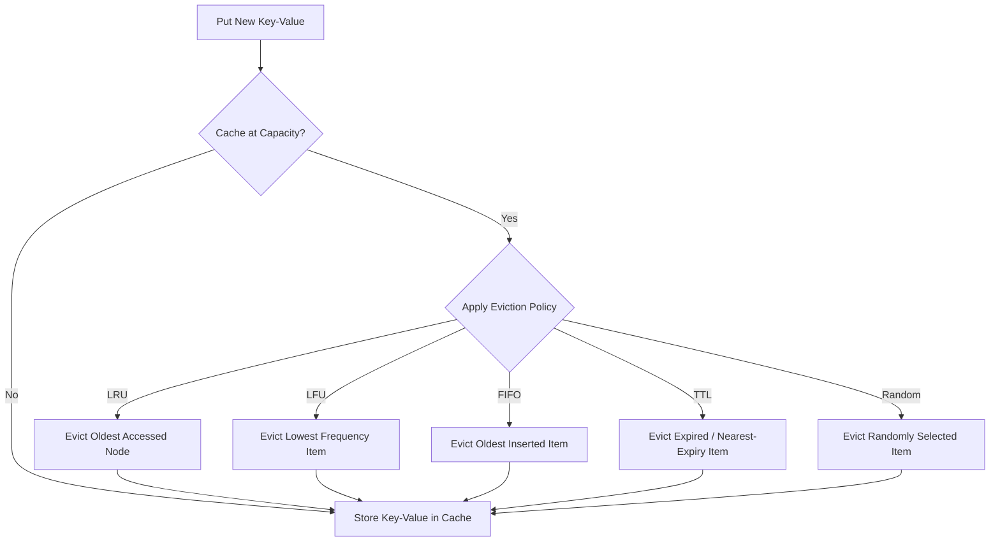

# Cache Eviction Policies in System Design (Core Java)

A comprehensive, production-grade guide and Core Java implementation of fundamental **Cache Eviction Policies** used in high-performance distributed systems, operating systems, and database buffer engines.

---

## Table of Contents
1. [Overview & Core Concepts](#1-overview--core-concepts)
2. [Eviction Policy Comparison Matrix](#2-eviction-policy-comparison-matrix)
3. [Deep Dive into Policies](#3-deep-dive-into-policies)
   - [1. LRU (Least Recently Used)](#1-lru-least-recently-used)
   - [2. LFU (Least Frequently Used)](#2-lfu-least-frequently-used)
   - [3. FIFO (First-In First-Out)](#3-fifo-first-in-first-out)
   - [4. TTL (Time-To-Live / Time-Based Expiration)](#4-ttl-time-to-live--time-based-expiration)
   - [5. Random Eviction](#5-random-eviction)
4. [Architecture & Class Design](#4-architecture--class-design)
5. [Concurrency & Thread Safety](#5-concurrency--thread-safety)
6. [Selection Guide: Choosing the Right Policy](#6-selection-guide-choosing-the-right-policy)
7. [Getting Started & Running Tests](#7-getting-started--running-tests)

---

## 1. Overview & Core Concepts

In any caching layer, storage memory (RAM) is finite. When the cache hits its maximum capacity and new data needs to be stored, an **eviction policy** (or replacement algorithm) determines which existing item must be purged to make room.



### Key Metrics for Eviction Algorithms:
- **Hit Ratio:** Percentage of total lookups served from cache ($\text{Hits} / (\text{Hits} + \text{Misses})$).
- **Time Complexity:** Read (`get`), Write (`put`), and Eviction must ideally operate in **$O(1)$** constant time.
- **Space Overhead:** Extra memory required to maintain access order or frequency counters.

---

## 2. Eviction Policy Comparison Matrix

| Policy | Underlying Data Structure | Get | Put | Evict | Memory Overhead | Best Used For |
| :--- | :--- | :---: | :---: | :---: | :---: | :--- |
| **LRU** | `HashMap` + Doubly Linked List | **$O(1)$** | **$O(1)$** | **$O(1)$** | Moderate (2 pointers per node) | Temporal locality (general web & API traffic) |
| **LFU** | `HashMap` + Frequency Buckets (`LinkedHashSet`) | **$O(1)$** | **$O(1)$** | **$O(1)$** | High (frequency maps + set nodes) | Long-term hot items, 80/20 Pareto workloads |
| **FIFO** | `LinkedHashMap` (Insertion Order) | **$O(1)$** | **$O(1)$** | **$O(1)$** | Low (single pointer chain) | Sequential pipelines, streaming ingest |
| **TTL** | `ConcurrentHashMap` + Scheduled Sweep | **$O(1)$** | **$O(1)$** | **$O(1)$** | Low (timestamp per entry) | Ephemeral data, auth tokens, rate limiters |
| **Random** | `HashMap` + Swap-to-Tail Dynamic Array | **$O(1)$** | **$O(1)$** | **$O(1)$** | Low (index map + array list) | Uniform access, low-overhead environments |

---

## 3. Deep Dive into Policies

### 1. LRU (Least Recently Used)

**Rule:** Evicts the item that has not been accessed for the longest period of time.

```
[Most Recently Used] <--- Head <== [Node A] <=> [Node B] <=> [Node C] ==> Tail ---> [Least Recently Used (Evict Next)]
```

* **Mechanism:**
  - On `get(K)`: Look up node in map in $O(1)$. Unlink node and move it to the `Head` of the doubly linked list.
  - On `put(K, V)`: If capacity reached, remove the node at `Tail.prev` (the least recently used), then insert the new node at `Head`.
* **Pros:** Highly effective for general read-heavy workloads where recently accessed keys are likely to be accessed again.
* **Cons:** Susceptible to **cache pollution** (e.g. a batch table scan will evict all hot data).

---

### 2. LFU (Least Frequently Used)

**Rule:** Tracks access counts and evicts the item with the lowest frequency. If multiple items share the lowest frequency, it breaks ties using LRU.

```
Freq 1 Bucket: [Node C] <=> [Node D] (minFrequency = 1, Evict Node C first)
Freq 2 Bucket: [Node B]
Freq 5 Bucket: [Node A]
```

* **Mechanism:**
  - Maintains `counts` (key $\to$ frequency) and `frequencyMap` (frequency $\to$ `LinkedHashSet` of keys).
  - Keeps track of `minFrequency` to find the eviction target in $O(1)$ without scanning.
* **Pros:** Ideal for power-law distributions where a core set of popular keys stays hot over long periods.
* **Cons:** Items that become suddenly hot in the past can stay in the cache forever even when no longer accessed (**frequency starvation / aging problem**).

---

### 3. FIFO (First-In First-Out)

**Rule:** Evicts entries in the exact sequence they were inserted into the cache, ignoring subsequent reads.

* **Mechanism:** Uses a queue or insertion-ordered linked list. New entries are appended to the tail; evictions occur from the head.
* **Pros:** Zero computational overhead for tracking access order or frequencies.
* **Cons:** Low hit ratio for non-sequential data; frequently accessed hot items can get evicted simply because they were added earlier (**Belady's Anomaly**).

---

### 4. TTL (Time-To-Live / Time-Based Expiration)

**Rule:** Every item has a lifespan. An item is considered invalid once its TTL expires.

* **Mechanism:**
  - **Passive Eviction:** During `get(K)`, the entry's timestamp is checked. If expired, it is removed immediately and returns `Optional.empty()`.
  - **Active Sweep:** A background thread (`ScheduledExecutorService`) sweeps through entries periodically to reclaim memory from keys that are never read again.
  - **Capacity Overflow:** If capacity is filled before TTL expiration, it purges the entry with the nearest expiration timestamp.
* **Pros:** Guarantees freshness; perfect for sessions, tokens, and volatile stats.
* **Cons:** Requires background thread overhead and timer management.

---

### 5. Random Eviction

**Rule:** Randomly picks an existing item to evict when capacity is reached.

* **Mechanism:** Maintains a `HashMap<K, V>` and an `ArrayList<K>`. On eviction:
  - Generates a random index $i \in [0, \text{size}-1]$.
  - Evicts the key at index $i$.
  - Replaces index $i$ with the last element in the array and removes the tail in **$O(1)$** time.
* **Pros:** Minimal memory tracking overhead; resistant to adversarial access patterns.
* **Cons:** Sub-optimal hit ratio compared to LRU/LFU under skewed workloads.

---

## 4. Architecture & Class Design

All policies implement a generic, strongly-typed interface:

```java
public interface Cache<K, V> {
    Optional<V> get(K key);
    void put(K key, V value);
    boolean remove(K key);
    void clear();
    int size();
    int capacity();
}
```

### Source File Directory

```
src/
+-- main/java/com/example/eviction/
¦   +-- Cache.java                         # Base generic interface
¦   +-- Main.java                          # End-to-end interactive runner
¦   +-- policies/
¦       +-- LruCache.java                  # O(1) LRU (Doubly-linked list + Map)
¦       +-- LfuCache.java                  # O(1) LFU (Frequency buckets + Map)
¦       +-- FifoCache.java                 # FIFO (Insertion-order LinkedHashMap)
¦       +-- TtlCache.java                  # TTL (Passive check + Active background sweep)
¦       +-- RandomEvictionCache.java       # O(1) Random (Swap-to-tail array deletion)
+-- test/java/com/example/eviction/
    +-- CacheEvictionTest.java             # JUnit 5 test suite
```

---

## 5. Concurrency & Thread Safety

All implementations in this repository are thread-safe:
- `LruCache`, `LfuCache`, `FifoCache`, and `RandomEvictionCache` utilize fine-grained `ReentrantLock` instances to coordinate atomic node mutations and index updates across concurrent threads.
- `TtlCache` utilizes `ConcurrentHashMap` combined with `ScheduledExecutorService` for thread-safe concurrent passive lookups and periodic active cleanup sweeps.

---

## 6. Selection Guide: Choosing the Right Policy

```
Does the data have a strict expiry lifespan?
 +-- Yes ---------------> Use [TTL Cache]
 +-- No
      +-- Sequential / Stream processing? -------> Use [FIFO Cache]
      +-- Long-term historical popularity? ------> Use [LFU Cache]
      +-- General-purpose / Recent access bias? -> Use [LRU Cache] (Default standard)
      +-- Uniform access / Minimal memory budget -> Use [Random Eviction]
```

---

## 7. Getting Started & Running Tests

### Prerequisites
- **JDK 17+**
- **Maven 3.8+**

### Commands

```powershell
# 1. Clone the repository
git clone https://github.com/Jatinghataliya/cache-eviction-policy.git
cd cache-eviction-policy

# 2. Run all unit tests
mvn test

# 3. Run the interactive demo
mvn compile exec:java -Dexec.mainClass="com.example.eviction.Main"
```
