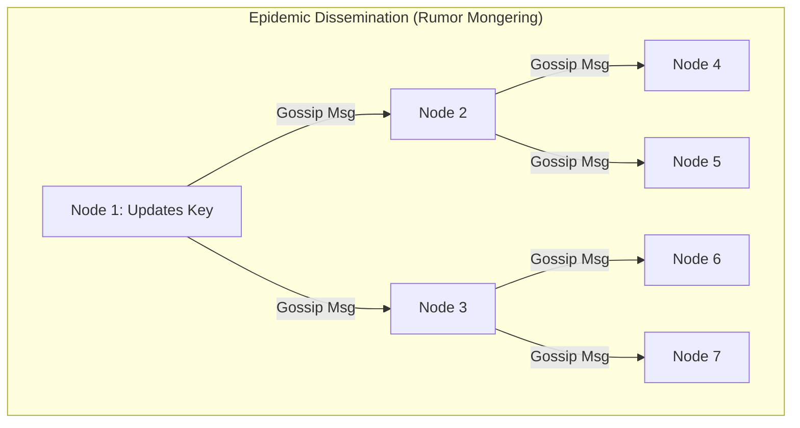
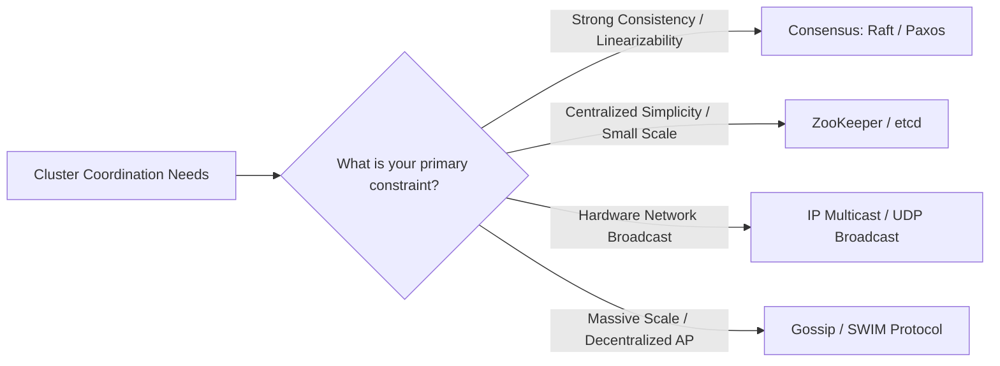
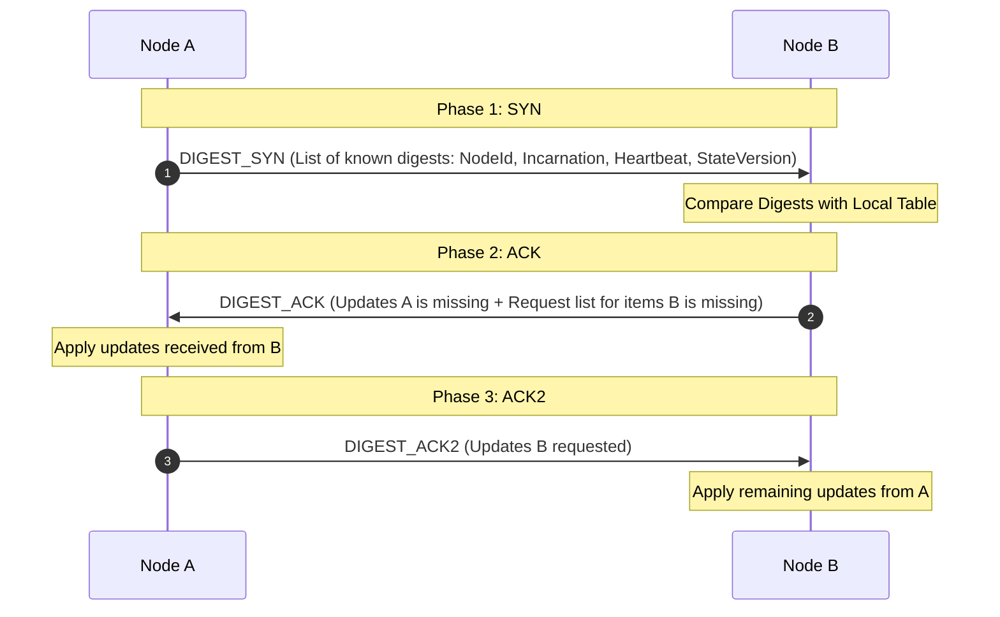
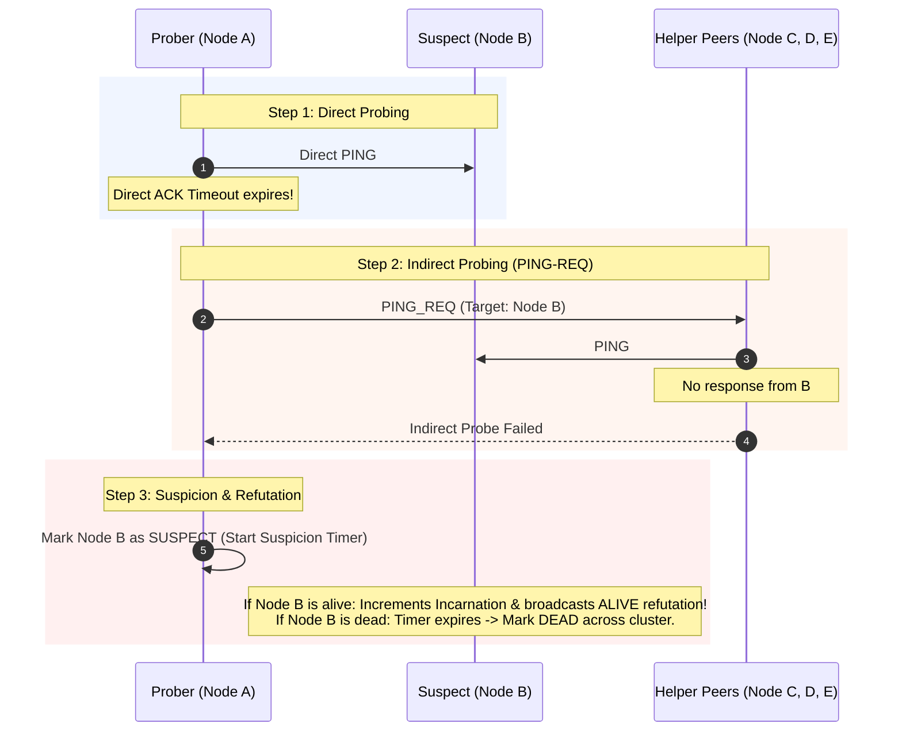

# 🗣️ Gossip Protocol & SWIM Failure Detector — Java Implementation

A production-grade, self-contained Java reference implementation and simulation of the **Gossip Protocol (Epidemic Protocol)** and **SWIM Failure Detector (Structured Weakly-consistent Infection-style Process Group Membership Protocol)**.

---

## 📖 Table of Contents
1. [Overview & Core Architecture](#-overview--core-architecture)
2. [1. What is Purpose of It?](#1-what-is-purpose-of-it)
3. [2. Why We Are Using It?](#2-why-we-are-using-it)
4. [3. When Should We Use It? (and When NOT)](#3-when-should-we-use-it)
5. [4. What is the Tradeoff of It?](#4-what-is-the-tradeoff-of-it)
6. [5. Advantages & Disadvantages](#5-advantages--disadvantages)
7. [6. Alternatives to Gossip Protocol](#6-alternatives-to-gossip-protocol)
8. [Theoretical Foundation & Mathematical Convergence](#-theoretical-foundation--mathematical-convergence)
9. [Protocol Deep Dive: Anti-Entropy vs Rumor Mongering](#-protocol-deep-dive-anti-entropy-vs-rumor-mongering)
10. [Failure Detection: SWIM Protocol with Suspicion & Refutation](#-failure-detection-swim-protocol-with-suspicion--refutation)
11. [Real-World Industry Applications](#-real-world-industry-applications)
12. [Project Architecture & Code Structure](#-project-architecture--code-structure)
13. [Build, Test & Execution Guide](#-build-test--execution-guide)

---

## 🏛️ Overview & Core Architecture

A **Gossip Protocol** (also called an **Epidemic Protocol**) is a decentralized, peer-to-peer communication mechanism modeled after the way epidemics or social rumors spread across a human population. 

In a distributed cluster of $N$ nodes without a central master:
1. Every node periodically selects $B$ random peers (fanout factor).
2. It exchanges local state, heartbeats, or event updates with those peers.
3. Information cascades exponentially across the cluster, reaching all online nodes in $O(\log N)$ communication rounds with high probability ($1 - e^{-c}$).



---

## 1. What is Purpose of It?

The primary purpose of the Gossip Protocol is to provide **decentralized, highly scalable, and fault-tolerant cluster management and state dissemination** without relying on a centralized coordinator or broadcast domain.

It solves three foundational problems in distributed systems:
1. **Cluster Membership Discovery:** How nodes dynamically join, discover peers, and form an interconnected cluster without a central registry.
2. **Failure Detection:** How to accurately detect dead or partitioned nodes in $O(1)$ network load per node without overwhelming the network with $O(N^2)$ point-to-point heartbeats.
3. **State Dissemination & Eventual Consistency:** How to broadcast configuration, topology changes, and schema updates so that all nodes eventually converge on identical state.

---

## 2. Why We Are Using It?

In small clusters ($N \le 10$), centralized registries (like ZooKeeper or etcd) or all-to-all heartbeating work fine. However, as clusters scale to hundreds or thousands of nodes ($N \ge 100$ to $10,000+$):

| Approach | Network Message Overhead per Period | Failure Sensitivity | Single Point of Failure? |
|---|---|---|---|
| **Centralized Master** (e.g., Coordinator Heartbeat) | $O(N)$ on Master | Master failure halts membership | **Yes** (Master bottleneck) |
| **All-to-All Heartbeats** (Mesh) | $O(N^2)$ across cluster | High false positives on network blips | **No** (Floods network bandwidth) |
| **Gossip Protocol (SWIM)** | $O(1)$ per node / $O(N)$ cluster total | Extremely low false positives (Indirect probing) | **No** (Fully decentralized) |

We use Gossip because:
- **Zero Single Point of Failure (SPOF):** Every node runs the exact same symmetric logic. Any node can crash without degrading the protocol.
- **Constant Per-Node Resource Usage:** Each node contacts a fixed number of peers $B$ (e.g., $B=2$ or $3$), regardless of whether the cluster has 10 nodes or 100,000 nodes.
- **Extreme Fault Tolerance:** Survives severe packet loss (30%+), transient network partitions, and node churn without losing state.

---

## 3. When Should We Use It?

### ✅ When to Use
- **Large-Scale Distributed Clusters ($N \ge 50$ to $10,000+$ nodes):** Distributed databases (Apache Cassandra, Amazon DynamoDB, ScyllaDB), cache grids (Redis Cluster), service meshes (HashiCorp Consul / Nomad Serf).
- **Decentralized Membership & Node Discovery:** Dynamic environments where nodes frequently join, leave, or restart (Kubernetes nodes, autoscaling groups).
- **Eventual Consistency Workloads:** Configuration distribution, feature flags, routing tables, and replica health telemetry.
- **Unreliable / Lossy Networks:** Edge computing, multi-datacenter WAN networks where packets drop or latency fluctuates.

### ❌ When NOT to Use
- **Strong Immediate Consistency (ACID):** If transactions require synchronous linearizability or atomic single-leader state (use Raft or Paxos instead).
- **Extremely Small Static Clusters ($N < 5$):** The probabilistic overhead and delayed convergence of gossip provide no benefit over a simple static configuration or direct ping.
- **Strict Real-Time Latency SLAs (< 1 ms):** Gossip relies on periodic ticks ($100\text{ ms} - 1\text{ s}$); state convergence takes $O(\log N)$ rounds.
- **Confidential / Multi-Tenant Isolation:** In pure gossip, messages flow through intermediate arbitrary peers; securing hop-by-hop payload integrity requires extra cryptographic overhead.

---

## 4. What is the Tradeoff of It?

| Dimension | Gossip Protocol Tradeoff | How to Tune |
|---|---|---|
| **Convergence Speed vs Bandwidth** | Faster dissemination requires higher fanout factor $B$ and shorter gossip intervals, consuming more CPU and network I/O. | Use Rumor Mongering for fast broadcast + periodic Anti-Entropy for background sync. |
| **Failure Detection Speed vs False Positives** | Aggressive timeouts detect crashed nodes in milliseconds but cause false alarms during minor GC pauses or packet spikes. | Use SWIM Suspicion Mechanism with indirect probing (`PING-REQ`) and incarnation refutation. |
| **Memory Footprint vs State Detail** | Full state replication on every node consumes $O(M \cdot N)$ memory. | Exchange cryptographic digests or version vectors rather than full raw payloads. |
| **Consistency vs Availability (CAP)** | Gossip favors **Availability and Partition Tolerance (AP)** over immediate consistency (CP). | Use version vectors / Last-Write-Wins (LWW) and CRDTs to resolve conflicting concurrent writes. |

---

## 5. Advantages & Disadvantages

### 🌟 Advantages
1. **Scalability:** Message traffic and CPU load scale logarithmically: $O(\log N)$ propagation rounds.
2. **Robustness & Self-Healing:** No coordinator election or failover downtime; if 50% of nodes die simultaneously, remaining nodes continue operating and discover each other.
3. **Bounded Network Traffic:** Predictable, constant network bandwidth consumption per node: $O(1)$ per tick.
4. **Resilience to Packet Drop:** Since rumors are gossiped multiple times over multiple distinct paths, message loss rate has negligible impact on final state convergence.
5. **Decentralized Simplicity:** Every node runs identical logic. No leader/follower state machine bifurcations.

### ⚠️ Disadvantages
1. **Eventual Consistency Latency:** Updates take several rounds ($T \cdot \log N$) to reach all nodes; intermediate temporary state discrepancies are expected.
2. **Redundant Message Transmission:** Multiple nodes will receive the same rumor multiple times (amortized message overhead).
3. **Debuggability & Determinism:** Asynchronous randomized message flows make reproducing specific distributed race conditions difficult without structured simulation logs.
4. **Byzantine Fault Vulnerability:** In basic gossip, a malicious or buggy node can inject bogus high incarnation numbers or corrupted states unless digital signatures are enforced.

---

## 6. Alternatives to Gossip Protocol



| Alternative | Consistency Model | Scalability | SPOF / Bottleneck | Best Used For |
|---|---|---|---|---|
| **Raft / Multi-Paxos** | Strong (CP / Linearizable) | Up to ~10–100 nodes | Leader node handles all write consensus | Distributed consensus, metadata, lock managers (etcd, Consul KV) |
| **Apache ZooKeeper** | Sequential Consistency (CP) | Up to ~20–50 nodes | Ensembles constrained by quorum size | Distributed locks, leader election, naming |
| **IP Multicast / Broadcast** | Best Effort | Local subnet only | Routers frequently drop/filter multicast | Low-latency local network telemetry (LAN only) |
| **Centralized Discovery (Eureka)** | Eventual (AP) | Up to ~1,000 instances | Central registry servers must be scaled | Traditional microservice registration |
| **Gossip Protocol (SWIM / Dynamo)** | Eventual (AP) | **10,000+ nodes** | **None (100% Peer-to-Peer)** | Membership, health monitoring, peer discovery |

---

## 📐 Theoretical Foundation & Mathematical Convergence

### Epidemic Spreading (SIR Model)
Gossip dissemination is modeled by the mathematical theory of epidemics (Classical SIR Model: *Susceptible $\to$ Infectious $\to$ Removed*):

- Let $x_t$ be the fraction of nodes that have **not** yet received the update at round $t$.
- Let $y_t = 1 - x_t$ be the fraction of nodes that have received the update.
- With fanout $B$, in round $t+1$:
  $$x_{t+1} = x_t \cdot \left(1 - \frac{1}{N}\right)^{B \cdot N \cdot y_t} \approx x_t \cdot e^{-B \cdot y_t}$$

### Convergence Proof
The number of communication rounds required to infect all $N$ nodes with high probability ($1 - \delta$) is:
$$\text{Rounds} = C \cdot \log_B(N) + O(\log(\ln(N)))$$

For example, in a cluster of **10,000 nodes** with fanout $B = 3$:
$$\text{Rounds} \approx \log_3(10,000) \approx 8.38 \implies \approx 9\text{ rounds}$$
At 1 second per tick, the entire 10,000-node cluster converges in **under 10 seconds**!

---

## 🔍 Protocol Deep Dive: Anti-Entropy vs Rumor Mongering

| Feature | Rumor Mongering (Dissemination) | Anti-Entropy (Reconciliation) |
|---|---|---|
| **Trigger** | Immediate when state changes (`put(k, v)`) | Periodic background timer (e.g. every 5s) |
| **Speed** | Ultra-fast ($O(\log N)$) | Slower, thorough background sweep |
| **Bandwidth** | Very low (Sends only delta / event) | Higher (Exchanges digests / version summaries) |
| **Guarantee** | High probability ($1 - \epsilon$), but can miss if partitioned | **100% Eventual Consistency guarantee** |
| **Analogy** | Breaking news spread by word of mouth | Auditing and reconciling account ledgers |

### 3-Phase Anti-Entropy Handshake (Cassandra / Dynamo Style)



---

## 🛡️ Failure Detection: SWIM Protocol with Suspicion & Refutation

Traditional heartbeat failure detectors suffer from a fundamental tradeoff: either accept high network traffic ($O(N^2)$) or suffer high false positive rates during packet loss.

**SWIM** (*Structured Weakly-consistent Infection-style Process Group Membership Protocol*) solves this in two steps:



### Incarnation Refutation Rule
1. Each node maintains a monotonic integer `incarnationNumber` (starts at 1).
2. If Node $X$ receives a rumor stating *"Node $X$ is SUSPECT with incarnation $I$"*:
   - Node $X$ increments its incarnation to $I + 1$.
   - Node $X$ broadcasts *"Node $X$ is ALIVE with incarnation $I + 1$"*.
3. Higher incarnation numbers strictly override lower incarnation rumors across all peers.

---

## 🏢 Real-World Industry Applications

1. **Apache Cassandra:** Uses Gossip for cluster metadata, token ring ranges, schema versions, node state (`UP`/`DOWN`), and datacenter awareness.
2. **Amazon DynamoDB / Dynamo Paper:** Pioneered decentralized gossip-based membership and push-pull anti-entropy for partition tolerance.
3. **HashiCorp Consul & Nomad (Serf / Memberlist):** Implements SWIM with Lifeguard extensions to manage tens of thousands of agent instances.
4. **Redis Cluster:** Nodes gossip cluster topology, hash slot assignments, and failover notifications over the cluster bus port (port + 10000).
5. **Bitcoin / Ethereum P2P:** Transactions and new blocks are gossiped over epidemic overlays to all validating peers.

---

## 📂 Project Architecture & Code Structure

```
SYSTEM-DESIGN/Gossip-Protocol/
├── pom.xml                                   # Maven build file (Java 17, JUnit 5)
├── README.md                                 # Comprehensive Documentation
└── src/
    ├── main/java/com/example/gossip/
    │   ├── Main.java                         # Interactive System Design Demo
    │   ├── core/
    │   │   ├── AntiEntropyEngine.java        # 3-Phase Push-Pull state reconciliation
    │   │   ├── Cluster.java                  # Multi-node simulation orchestrator
    │   │   ├── FailureDetector.java          # SWIM Failure Detector with Suspicion
    │   │   ├── GossipNode.java               # Node lifecycle, membership & state store
    │   │   └── RumorMongerEngine.java        # Epidemic SIR rumor dissemination
    │   ├── model/
    │   │   ├── GossipDelta.java              # State updates container
    │   │   ├── GossipDigest.java             # Version & heartbeat summary
    │   │   ├── Message.java                  # Protocol network envelope
    │   │   ├── MessageType.java              # PING, ACK, PING_REQ, SYN, ACK, ACK2, RUMOR
    │   │   ├── NodeId.java                   # Host/port node identifier
    │   │   ├── NodeMember.java               # Membership entry & versioned state
    │   │   ├── NodeStatus.java               # ALIVE, SUSPECT, DEAD, LEFT
    │   │   └── RumorEvent.java               # Epidemic broadcast payload
    │   └── network/
    │       ├── NetworkChannel.java           # Network abstraction interface
    │       └── NetworkSimulator.java         # In-memory simulator (latency, drops, partitions)
    └── test/java/com/example/gossip/
        └── GossipProtocolTest.java           # 100% passing JUnit 5 test suite
```

---

## 🚀 Build, Test & Execution Guide

### Prerequisites
- **Java 17+**
- **Maven 3.8+**

### 1. Run Unit & Integration Tests
```bash
cd Gossip-Protocol
mvn test
```

### 2. Run the Interactive Console Demo
```bash
mvn compile exec:java
```

### Demo Output Highlights:
- **Demo 1:** Seed node bootstrapping and automatic peer discovery.
- **Demo 2:** Epidemic dissemination propagating state across 6 nodes in $O(\log N)$ ticks.
- **Demo 3:** SWIM protocol escalating a crashed node from direct probe failure $\to$ indirect `PING-REQ` $\to$ `SUSPECT` $\to$ `DEAD`.
- **Demo 4:** Network partition isolation, divergent mutations, and automated 3-phase Anti-Entropy healing.
