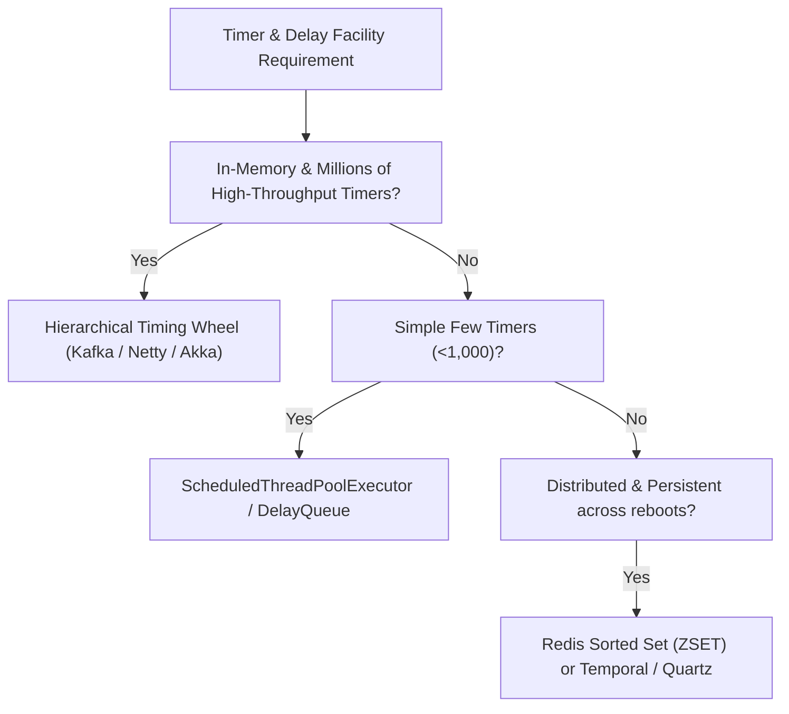

# Hierarchical Timing Wheel in System Design

A comprehensive reference implementation and system design guide on **Hashed and Hierarchical Timing Wheels**: what they are, why they exist, how they operate, their tradeoffs, advantages and disadvantages, and what alternatives to use.

---

## Table of Contents
1. [What Is a Hierarchical Timing Wheel?](#1-what-is-a-hierarchical-timing-wheel)
2. [What Is Its Purpose?](#2-what-is-its-purpose)
3. [Why Do We Use It?](#3-why-do-we-use-it)
4. [When Should We Use It?](#4-when-should-we-use-it)
5. [Tradeoffs](#5-tradeoffs)
6. [Advantages and Disadvantages](#6-advantages-and-disadvantages)
7. [Alternatives](#7-alternatives)
8. [Quick Decision Guide](#8-quick-decision-guide)
9. [Architecture and How It Works](#9-architecture-and-how-it-works)
10. [Algorithmic Complexity](#10-algorithmic-complexity)
11. [Java Reference Implementation](#11-java-reference-implementation)
12. [Running the Project](#12-running-the-project)

---

## 1. What Is a Hierarchical Timing Wheel?

A **Timing Wheel** (originally proposed by *George Varghese and Anthony Lauck in 1987*) is a circular buffer of timer lists (buckets) where each slot represents a time unit (tick). As a clock hand advances tick by tick, expired tasks in the current slot are removed and executed.

A **Hierarchical Timing Wheel** extends this by chaining multiple timing wheels of increasing granularity — analogous to the seconds, minutes, hours, and days hands of an analog clock or odometer:
- **Layer 0 (Seconds / Milliseconds):** High resolution (e.g., 20ms ticks, 20 slots $\to$ 400ms range).
- **Layer 1 (Seconds):** Coarser resolution (e.g., 400ms ticks, 20 slots $\to$ 8,000ms range).
- **Layer 2 (Minutes):** Coarser resolution (e.g., 8,000ms ticks, 20 slots $\to$ 160,000ms range).
- **Layer $M$ (Hours/Days):** Handles long-horizon timeouts without allocating trillions of empty low-level slots.

When a higher-level slot expires, tasks contained within it are **cascaded down** (re-inserted) into the lower-level timing wheels until they reach Layer 0 and fire at their exact deadline.

```
                           +------------------------+
                           |  Layer 2 (Minutes)     |  tick = 8s, span = 160s
                           +-----------+------------+
                                       | cascades down on slot expiry
                                       v
                           +------------------------+
                           |  Layer 1 (Seconds)     |  tick = 400ms, span = 8s
                           +-----------+------------+
                                       | cascades down on slot expiry
                                       v
                           +------------------------+
                           |  Layer 0 (Sub-Second)  |  tick = 20ms, span = 400ms
                           +-----------+------------+
                                       | executes expired tasks
                                       v
                              [ EXECUTED CALLBACK ]
```

---

## 2. What Is Its Purpose?

In modern distributed systems, servers routinely manage **hundreds of thousands or millions of concurrent timers** (e.g., TCP connection timeouts, heartbeat / keep-alive detectors, session TTLs, retry delays, and delayed messaging).

The purpose of a Hierarchical Timing Wheel is to provide **$O(1)$ constant time complexity for scheduling and cancelling timers**, avoiding the $O(\log N)$ CPU bottleneck and lock contention of traditional Min-Heap priority queues.

It solves the scalability bottleneck:
> *"How do we manage 10,000,000 concurrent timers with sub-millisecond overhead for insertion and cancellation without burning CPU on sorting or polling empty time slots?"*

---

## 3. Why Do We Use It?

### The Problem with Min-Heap Timers (`java.util.Timer`, `PriorityQueue`, `ScheduledThreadPoolExecutor`)
Standard timer implementations use a binary min-heap sorted by task expiration time:
- **Insertion:** $O(\log N)$ heap-up operations.
- **Cancellation:** $O(N)$ linear search or $O(\log N)$ heap-down if entry pointers are indexed.
- **Tick / Poll:** $O(\log N)$ extraction.

When $N = 1,000,000$:
- Every connection ping requires $O(\log N) \approx 20$ comparisons and pointer swaps.
- Under 100k requests/sec, the min-heap locks and saturates multiple CPU cores purely on heap rebalancing.

```mermaid
flowchart TD
    A["1,000,000 Heartbeat Timers"] --> B{"Min-Heap Timer (PriorityQueue)"}
    B -->|O(log N) insert / cancel| C["Heavy CPU overhead & lock contention"]
    C --> D["Heartbeat delays, false disconnects & latency spikes"]

    A --> E{"Hierarchical Timing Wheel"}
    E -->|O(1) insert / O(1) cancel| F["Constant memory & negligible CPU load"]
    F --> G["Millions of timers handled at sub-microsecond latency"]
```

### Why Hierarchical Timing Wheel Solves This

| Metric | Min-Heap / `ScheduledThreadPoolExecutor` | Single Timing Wheel | Hierarchical Timing Wheel |
| :--- | :--- | :--- | :--- |
| **Insert Task** | $O(\log N)$ | $O(1)$ | $O(M) \approx O(1)$ |
| **Cancel Task** | $O(N)$ or $O(\log N)$ | $O(1)$ | $O(1)$ |
| **Per-Tick Cost** | $O(\log N)$ | $O(1)$ or $O(\text{bucket\_size})$ | $O(1) + O(\text{cascaded\_tasks})$ |
| **Memory for Large Horizon** | $O(N)$ | $O(\text{Range} / \text{Tick})$ (Explodes!) | $O(M \times \text{WheelSize} + N)$ (Extremely compact) |
| **Lock Contention** | High (global tree lock) | Low (per-bucket locks) | Minimal (bucket doubly-linked lists) |

---

## 4. When Should We Use It?

### Best Fit Scenarios
1. **Network Connection Timeouts & Heartbeats:** Managing TCP idle timeouts, WebSocket keep-alives, and gRPC ping deadlines across millions of open sockets (e.g., Netty `HashedWheelTimer`).
2. **Distributed Message Brokers & Delayed Queues:** Tracking delayed delivery, message ACK timeouts, and delayed purgatory requests (e.g., Apache Kafka `kafka.utils.timer.TimingWheel`).
3. **Cache / Session Expiration:** Expiring millions of short-lived sessions or ephemeral cache keys with predictable TTLs.
4. **RPC & HTTP Client Request Timeouts:** Enforcing per-request deadlines across microservice clusters.
5. **Rate Limiting & Token Bucket Refills:** Scheduling sliding-window and token refill events.

### When NOT to Use It
| Situation | Recommended Alternative |
| :--- | :--- |
| **Small number of timers ($N < 1,000$)** | Standard `ScheduledExecutorService` (simpler, zero overhead). |
| **Long-running cron jobs with complex calendar rules (e.g. 1st Monday of Month)** | Quartz Scheduler or Cron parser. |
| **Persistent distributed workflows across node restarts** | Temporal, Cadence, or database-backed task queues. |
| **Hard real-time systems requiring microsecond precision** | Hardware timer / OS real-time clock interrupts. |

---

## 5. Tradeoffs

| You Gain | You Give Up |
| :--- | :--- |
| **$O(1)$ scheduling and cancellation** at massive scale ($10^6+$ timers) | **Granularity / Accuracy:** Expirations are bucketed to tick boundaries (e.g. within $\pm \text{tickMs}$). |
| **Constant memory overhead** across multi-tier wheels | **Cascading Overhead:** When high-tier buckets expire, contained tasks are re-inserted into lower wheels. |
| **Zero empty-slot busy spinning** (when coupled with `DelayQueue` bucket management) | **In-memory state:** Tasks are held in JVM heap (needs external persistent store for durable delayed events). |

---

## 6. Advantages and Disadvantages

### Advantages
1. **Predictable $O(1)$ Operations:** Adding, removing, or refreshing a timer is bounded by a handful of pointer updates.
2. **Scales to Millions of Timers:** Memory and CPU costs remain linear with active task count.
3. **Dynamic Multi-Tier Spanning:** Can seamlessly handle timeouts from 10 milliseconds to several months.
4. **O(1) Cancellation via Doubly-Linked Bucket Nodes:** Tasks store a pointer to their bucket list node and can unlink themselves instantly.
5. **Zero Busy-Spinning (Kafka Optimization):** Non-empty buckets are placed in a Java `DelayQueue`, allowing the driver thread to sleep until the next non-empty bucket expires.

### Disadvantages
1. **Tick Jitter:** Execution time is accurate up to one tick interval.
2. **Cascade Latency Spikes:** If thousands of tasks land in the same high-level bucket, cascading them down simultaneously can cause transient CPU bursts.
3. **Complexity:** Significantly more complex than standard JDK priority queues.

---

## 7. Alternatives



### Alternatives Comparison

| System / Facility | Architecture | Time Complexity | Persistence | Scalability |
| :--- | :--- | :--- | :--- | :--- |
| **Hierarchical Timing Wheel** | Multi-tier ring buffer + doubly-linked lists | $O(1)$ insert, $O(1)$ cancel | In-memory | Millions of timers/sec |
| **Netty HashedWheelTimer** | Single wheel with round-counter | $O(1)$ insert, $O(1)$ cancel | In-memory | Hundreds of thousands/sec |
| **ScheduledThreadPoolExecutor** | Binary Min-Heap | $O(\log N)$ insert, $O(N)$ cancel | In-memory | Low ($\le 10,000$ timers) |
| **Redis Sorted Set (`ZSET`)** | SkipList + Hash table (scores = timestamp) | $O(\log N)$ add/remove | Persistent | $50,000+$ ops/sec per node |
| **Quartz Scheduler / Temporal** | Database tables & polling state machine | $O(\text{DB query})$ | Durable DB | Enterprise workflows |

---

## 8. Quick Decision Guide

```
Number of active timers < 1,000?                  --> ScheduledThreadPoolExecutor
High-throughput network timeouts (Netty/Kafka)?   --> Hierarchical Timing Wheel (this module)
Need cross-process distributed TTL?               --> Redis ZSet (ZRANGEBYSCORE)
Need durable long-running business workflows?     --> Temporal / Cadence / Quartz
```

---

## 9. Architecture and How It Works

### Doubly-Linked List Bucket Structure
Each bucket in a wheel tier is a `TimerTaskList` composed of circular doubly-linked `TimerTaskEntry` nodes:

```
[Bucket Head / Sentinel] <---> [Task Entry 1] <---> [Task Entry 2] <---> [Task Entry 3]
```
- Adding a task: Appends to tail $\to O(1)$.
- Cancelling a task: Unlinks `entry.prev` and `entry.next` $\to O(1)$.

### Cascading Down Mechanics
When Layer 1 advances past a slot:
1. All task entries in that slot are flushed out.
2. Each task's remaining delay is evaluated against Layer 0.
3. If remaining delay $< \text{Layer 0 Interval}$, it is re-inserted into Layer 0 at the exact bucket index.
4. If remaining delay $\le 0$, it is immediately dispatched to worker threads.

---

## 10. Algorithmic Complexity

| Operation | Time Complexity | Space Complexity |
| :--- | :--- | :--- |
| `add(TimerTask)` | $O(M)$ where $M$ = wheel hierarchy depth ($M \le 4 \implies O(1)$) | $O(1)$ |
| `cancel()` | $O(1)$ pointer unlinking | $O(1)$ |
| `advanceClock(timeout)` | $O(1)$ bucket pop + $O(K)$ where $K$ is tasks in expired slot | $O(1)$ |
| Total Space | — | $O(M \times W + N)$ ($W$=wheel size, $N$=active tasks) |

---

## 11. Java Reference Implementation

This project contains clean, thread-safe, production-ready Java 17 implementations:

- **[`TimerTask`](src/main/java/com/example/timingwheel/TimerTask.java):** Base task class supporting delay tracking and $O(1)$ self-cancellation.
- **[`TimerTaskEntry`](src/main/java/com/example/timingwheel/TimerTaskEntry.java):** Doubly-linked node element inside buckets.
- **[`TimerTaskList`](src/main/java/com/example/timingwheel/TimerTaskList.java):** Circular doubly-linked list bucket implementing Java `Delayed`.
- **[`TimingWheel`](src/main/java/com/example/timingwheel/TimingWheel.java):** Single wheel tier with slot math and lazy overflow tier generation.
- **[`HierarchicalTimingWheel`](src/main/java/com/example/timingwheel/HierarchicalTimingWheel.java):** Kafka-style multi-tier timer engine backed by `DelayQueue`.
- **[`SystemTimer`](src/main/java/com/example/timingwheel/SystemTimer.java):** High-level execution service with worker pool and background tick driver.
- **[`Main`](src/main/java/com/example/timingwheel/Main.java):** Interactive CLI demonstration with 100k connection heartbeat benchmarks.

---

## 12. Running the Project

### Prerequisites
- JDK 17+
- Maven 3.8+

### Run Unit Tests
```bash
cd Hierarchical-Timing-Wheel
mvn clean test
```

### Run Interactive Demonstration
```bash
cd Hierarchical-Timing-Wheel
mvn compile exec:java
```

---

## Author
**Jatin Ghataliya** · [prajapati.jatin94@gmail.com](mailto:prajapati.jatin94@gmail.com)
