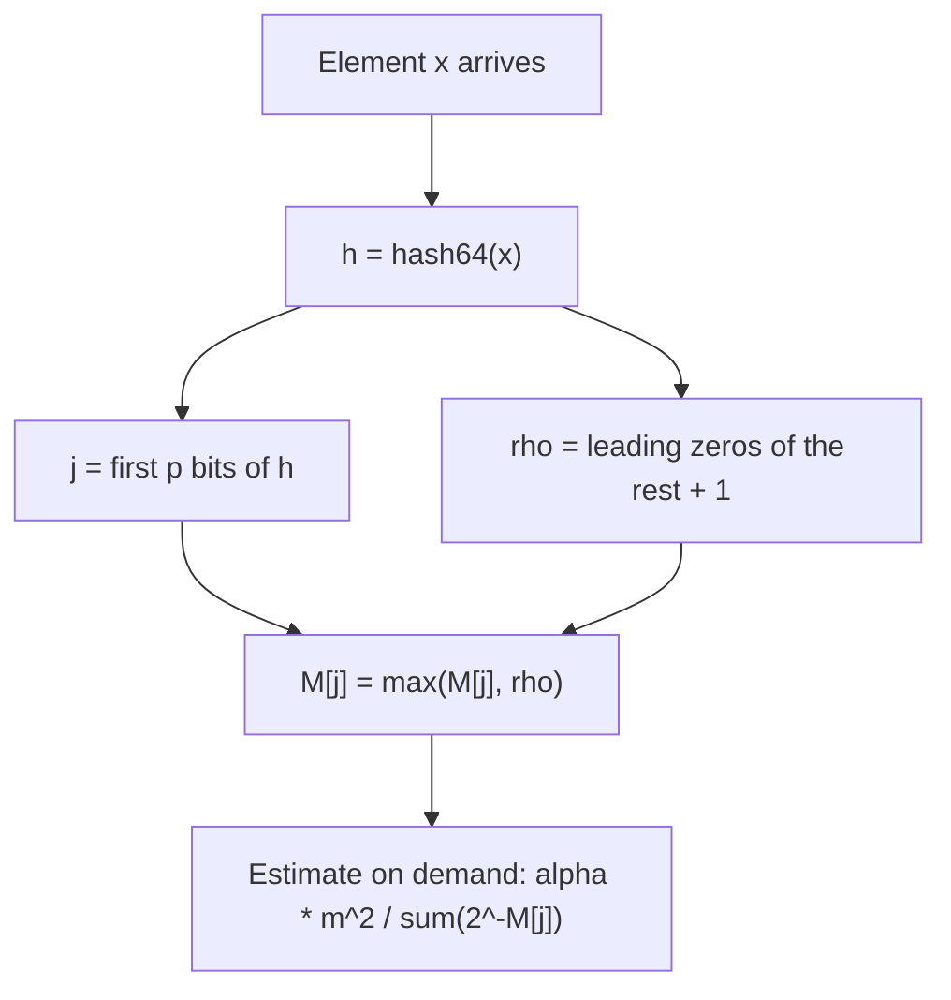
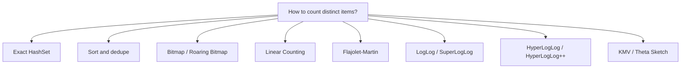
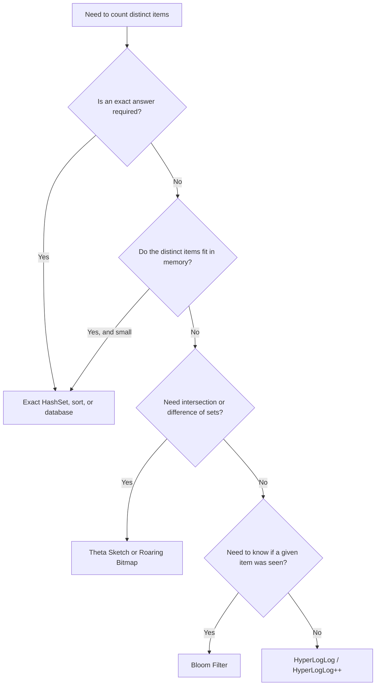

# HyperLogLog in System Design

A reference on **HyperLogLog (HLL)**: what it is, why it exists, when to use it, its tradeoffs,
and what to use instead.

---

## Table of Contents
1. [What Is HyperLogLog?](#1-what-is-hyperloglog)
2. [What Is Its Purpose?](#2-what-is-its-purpose)
3. [Why Do We Use It?](#3-why-do-we-use-it)
4. [When Should We Use It?](#4-when-should-we-use-it)
5. [Tradeoffs](#5-tradeoffs)
6. [Advantages and Disadvantages](#6-advantages-and-disadvantages)
7. [Alternatives](#7-alternatives)
8. [Quick Decision Guide](#8-quick-decision-guide)
9. [Real-World Usage](#9-real-world-usage)
10. [Java Implementation](#10-java-implementation)
11. [Running the Project](#11-running-the-project)

---

## 1. What Is HyperLogLog?

**HyperLogLog** is a probabilistic data structure that estimates the **number of distinct elements**
(the *cardinality*) of a very large set, using a tiny, fixed amount of memory. It was introduced by
Flajolet, Fusy, Gandouet and Meunier (2007), and refined by Google as **HyperLogLog++** (2013).

Instead of remembering every element it has seen, it remembers only a small summary of the *hash
values* of those elements. The count is approximate, but the error is known in advance and does not
depend on how large the set is.

### The core intuition

Hash every element to a uniformly random bit string. Look at the number of **leading zeros**.

- Half of all hashes start with `1` (0 leading zeros).
- A quarter start with `01` (1 leading zero).
- One in `2^k` starts with `k` zeros.

So if the longest run of leading zeros you have ever seen is `k`, you have probably seen about
`2^k` distinct elements. This is like flipping a coin: if the longest streak of heads you saw is
10 in a row, you probably flipped around 1,000 times.

A single such observation is very noisy. HyperLogLog fixes that by **splitting the stream into `m`
buckets** (called registers), tracking the maximum in each, and averaging the results.

Duplicates are free: the same element always produces the same hash, so it can never change a
register after the first time.

### Parameters

| Symbol | Meaning |
| :--- | :--- |
| `p` | **Precision.** Number of hash bits used to pick a register. Typical range 4 to 18 |
| `m = 2^p` | Number of registers |
| `M[j]` | Register `j`. Holds the largest "leading zeros + 1" seen in that bucket |
| Standard error | `1.04 / sqrt(m)` |

### The algorithm

**Add an element:**

1. Compute a 64-bit hash `h` of the element.
2. The first `p` bits of `h` select the register index `j`.
3. In the remaining bits, count the leading zeros and add 1. Call this `rho`.
4. Set `M[j] = max(M[j], rho)`.

**Estimate the count:**

```
E = alpha_m * m^2 / ( sum over j of 2^(-M[j]) )
```

This is a **harmonic mean** of `2^M[j]` across registers. The harmonic mean is used because it is
not dragged upward by a few registers that got unlucky, very large values. `alpha_m` is a constant
that removes bias, approximately `0.7213 / (1 + 1.079 / m)` for `m >= 128`.

**Range corrections:**

| Range | Problem | Fix |
| :--- | :--- | :--- |
| Small (`E <= 2.5 * m`) and some registers still zero | Raw estimate is biased low | Use **Linear Counting**: `m * ln(m / V)`, where `V` is the number of zero registers |
| Large with 32-bit hashes | Hash collisions bias the estimate | Apply a large-range correction. **Not needed with 64-bit hashes** |

HyperLogLog++ goes further: 64-bit hashes, an empirical bias-correction table for the mid range,
and a compact **sparse representation** that stores only non-zero registers while the set is small.



### Worked example

Use `p = 2`, so `m = 4` registers, and an 8-bit hash for readability. The first 2 bits pick the
register, the remaining 6 bits give `rho`.

| Element | Hash (index / rest) | Register `j` | Leading zeros in rest | `rho` | Effect |
| :--- | :--- | :--- | :--- | :--- | :--- |
| `x` | `01` / `001000` | 1 | 2 | 3 | `M[1] = 3` |
| `y` | `10` / `100000` | 2 | 0 | 1 | `M[2] = 1` |
| `z` | `01` / `000010` | 1 | 4 | 5 | `M[1] = max(3, 5) = 5` |
| `x` again | `01` / `001000` | 1 | 2 | 3 | `M[1]` stays 5 (duplicate, no change) |

Registers after these inserts: `M = [0, 5, 1, 0]`. Adding `x` a second time changed nothing. That is
why HyperLogLog counts **distinct** elements and not total occurrences.

### Merging

Two HyperLogLogs built with the same `p` and the same hash function merge by taking the
**element-wise maximum** of their registers:

```
merged.M[j] = max(a.M[j], b.M[j])
```

The result is *exactly* the sketch you would have got by feeding both streams into one HyperLogLog.
Merging is lossless, order independent and safe to repeat, so it works naturally across machines,
time windows and partitions.

### Guarantees

| Property | Value |
| :--- | :--- |
| Standard error | `1.04 / sqrt(m)`. About 68% of estimates fall within this error, about 95% within twice it |
| Memory | `m` registers, each only 5 to 6 bits for 64-bit hashes. Independent of the number of distinct elements |
| Update time | O(1) |
| Query time | O(m) |
| Reach | Can count into the billions and beyond with a few KB |

### Precision vs. memory vs. error

| `p` | Registers `m` | Memory (6 bits each) | Standard error |
| :--- | :--- | :--- | :--- |
| 10 | 1,024 | 768 B | 3.25% |
| 12 | 4,096 | 3 KB | 1.63% |
| 14 | 16,384 | 12 KB | **0.81%** |
| 16 | 65,536 | 48 KB | 0.41% |
| 18 | 262,144 | 192 KB | 0.20% |

The 12 KB, 0.81% setting (`p = 14`) is the widely used default, for example in Redis.

---

## 2. What Is Its Purpose?

The purpose is to **answer "how many distinct items have I seen?" using a few kilobytes**, no matter
whether the answer is a thousand or a hundred billion.

It answers one question in a single pass:

> "How many *unique* users, IPs, queries or keys are in this data?"

It reads each element once, never stores the elements, and can report an estimate at any time.
Because sketches merge, it can also answer the same question for a union of many sets.

It does **not** tell you *which* elements were seen, or *whether* a specific element was seen. It
only gives the count.

---

## 3. Why Do We Use It?

### The problem with exact distinct counting

Counting unique items exactly requires remembering every item you have seen, so you can tell whether
a new one is a duplicate. Memory grows linearly with the number of distinct items.

| Scheme | Memory for 1 billion distinct 64-bit IDs | Result |
| :--- | :--- | :--- |
| `HashSet` | At least 8 GB raw, usually 3 to 5 times more with object and hash overhead | Exact count, but may not fit in memory |
| Bitmap (one bit per possible ID) | 125 MB for a 1-billion ID space, grows with the ID space | Exact, only works for small dense integer IDs |
| HyperLogLog (`p = 14`) | **12 KB** | Count within about 0.81% |

That is roughly a **million times** less memory.

### Exact counting is also hard to distribute

To count unique users across 100 servers exactly, you must ship every ID to one place, or
deduplicate across nodes. Summing per-node unique counts gives the wrong answer because the same
user can appear on many nodes.

With HyperLogLog each node keeps a 12 KB sketch. You send the sketches, take the register-wise
maximum, and read off the union cardinality.

### Why that matters

- **Tiny, fixed memory.** Size depends on the precision `p` you pick, not on the data.
- **Single pass.** The data can be streamed and thrown away.
- **Mergeable.** Union of sets = max of registers. Ideal for sharded and time-windowed data.
- **Known error.** The relative error is a function of `m`, and is the same for 1 thousand or 1 billion elements.
- **Cheap updates.** One hash and one comparison per element.
- **Precomputable.** Store one small sketch per day, per country or per campaign, and combine later to answer any union query.

---

## 4. When Should We Use It?

Use HyperLogLog when you need a **count of distinct items over a large or distributed data set** and
a small relative error (about 1%) is acceptable.

| Scenario | Why it fits |
| :--- | :--- |
| **Unique visitors / daily active users** | Billions of events, only the unique count is needed |
| **Unique search queries, IPs or URLs** | Count distinct values without storing them |
| **Database `COUNT(DISTINCT ...)`** | Approximate distinct aggregates over huge tables, much faster and cheaper |
| **Network monitoring** | Detect scans or DDoS by counting distinct destination ports or source IPs per host |
| **Analytics rollups** | Store one sketch per hour, merge any range of hours to get unique users over that range |
| **Ad impressions and reach** | Unique people reached across campaigns, with unions across campaigns |
| **Distributed counting** | Each node sketches locally, sketches are merged centrally |
| **Query planning** | Estimate column cardinality for optimizer statistics |

Use it especially when:
- The number of distinct items is too big to store, or too big to ship between machines.
- You need **unions** of sets, across time, shards or dimensions.
- A relative error of 1 to 2% is fine.
- You only need the count, not the members.

### When you should not use it

| Situation | Better choice |
| :--- | :--- |
| You need an **exact** count (billing, finance, compliance) | Exact `HashSet`, sort + dedupe, or a database |
| The distinct count is small (thousands) | A `HashSet`. It is exact and costs little |
| You need to know **whether a specific element** was seen | Bloom Filter, Cuckoo Filter |
| You need to list or retrieve the distinct elements | `HashSet`, database |
| You need to know **how often** an item occurred | Count-Min Sketch |
| You need the most **frequent** items | Lossy Counting, Space-Saving, Misra-Gries |
| You need to **delete** items or have a count go down | Not supported. Rebuild from the source, or use a sketch designed for deletions |
| You need **intersection** or **difference** of sets with good accuracy | Theta Sketch (DataSketches) |
| You need quantiles or percentiles | t-digest, GK sketch |

---

## 5. Tradeoffs

HyperLogLog buys **tiny fixed memory, mergeability and constant-time updates**. It pays with
accuracy and with the kinds of questions it can answer.

| You gain | You give up |
| :--- | :--- |
| A few KB of memory regardless of data size | **Exact counts.** Typical error is around 1%, and individual estimates can be off by 2 to 3 times that |
| O(1) update, trivial to run on a hot path | **Membership queries.** You cannot ask whether `x` was seen |
| Lossless merge by taking register maximum | **Element access.** The elements are gone, only the count remains |
| Same relative error at any scale | **Deletes.** There is no way to remove an element |
| Easy to distribute and to store per time window | **Accurate intersections.** Only possible through inclusion-exclusion, with large error |
| No need to store or replay the stream | **Determinism across hash functions.** Sketches built with different hashes or different `p` cannot be merged directly |

### Key tradeoff: choice of precision `p`

| Lower `p` | Higher `p` |
| :--- | :--- |
| Less memory | More memory |
| Larger error (`1.04 / sqrt(m)`) | Smaller error |
| Faster merge and query (fewer registers) | Slower merge and query |
| Good for millions of tiny per-key sketches (per user, per page, per campaign) | Good for a small number of high-value counters |

Error shrinks only with `sqrt(m)`. Halving the error needs **4 times** the memory, so there are
quickly diminishing returns. Pick the smallest `p` that meets the accuracy you actually need.

### Key tradeoff: many small sketches vs. one exact set

If you track unique visitors **per page** across millions of pages, an exact set per page is
impossible. A 12 KB sketch per page is practical, and with sparse encoding it can be a few hundred
bytes while the page is small.

### Key tradeoff: HyperLogLog vs. Bloom Filter vs. Count-Min Sketch

| | HyperLogLog | Bloom Filter | Count-Min Sketch |
| :--- | :--- | :--- | :--- |
| Question answered | How many **distinct**? | Is `x` **present**? | How **often** did `x` occur? |
| Output | A number | Yes / probably yes | A count for an item |
| Error | Relative, about `1.04 / sqrt(m)` | False positives | Overestimates |
| Size | Fixed, tiny | Grows with the number of elements | Fixed |
| Mergeable | Yes, max | Yes, bitwise OR | Yes, add |

They are complementary, not competing. Each answers a different question.

---

## 6. Advantages and Disadvantages

### Advantages

1. **Tiny memory.** About 12 KB for a 0.81% error, even for billions of elements.
2. **Fixed size.** Memory does not grow with the data, so capacity planning is easy.
3. **Constant-time updates.** One hash and one register update.
4. **Mergeable.** Union is a register-wise max: lossless, commutative, associative and idempotent.
5. **Distributed friendly.** Nodes sketch locally and send only a few KB.
6. **Duplicates are free.** Adding the same element repeatedly never changes the result.
7. **Predictable error.** Relative error is known up front and does not depend on cardinality.
8. **Precomputable.** Store sketches per window or per dimension and answer union queries later.
9. **Single pass.** The raw data does not need to be kept.
10. **Widely supported.** Built into Redis, BigQuery, Presto/Trino, Spark, Elasticsearch, Druid and more.

### Disadvantages

1. **Approximate.** Not suitable where exact counts are required.
2. **Count only.** No membership test, no element listing, no frequency.
3. **No deletion.** Registers only ever grow. To drop data you must rebuild the sketch.
4. **Weak for intersections.** Intersection and difference are only available through inclusion-exclusion, which can have a very large relative error when the overlap is small.
5. **Error improves slowly.** Error falls with `sqrt(m)`, so 2x accuracy costs 4x memory.
6. **Hash quality matters.** A poor hash function biases the estimate. A good 64-bit hash (for example Murmur3 or xxHash) is required.
7. **Hash must be consistent.** Sketches can only be merged if they used the same hash function, seed and `p`.
8. **Small-range bias.** The raw estimator is inaccurate for small counts. It needs the Linear Counting correction, or HyperLogLog++ bias tables.
9. **Needs correct implementation.** Bias correction, range handling and sparse encoding are easy to get subtly wrong. A tested library is usually better than a hand-rolled version.
10. **Hard to debug.** Because the data is gone, a wrong estimate cannot be traced back to elements.

---

## 7. Alternatives

### Overview



### Comparison

| Approach | How it works | Strengths | Weaknesses | Used by |
| :--- | :--- | :--- | :--- | :--- |
| **Exact `HashSet`** | Store every distinct item | Exact, simple, supports membership | Memory is O(distinct items), hard to distribute | Small data sets |
| **Sort and dedupe** | Sort, then count unique | Exact, works on disk | Needs the full data and a lot of I/O | Batch jobs, `SELECT COUNT(DISTINCT)` in classic databases |
| **Bitmap / Roaring Bitmap** | One bit per possible integer ID, compressed | Exact, fast set operations including intersection | Needs dense integer IDs, memory grows with the ID space | Search indexes, analytics engines (Druid, Pinot) |
| **Linear Counting** | Hash into a bit array, count the empty bits | Very accurate for small counts | Memory grows with cardinality | Used inside HyperLogLog for small ranges |
| **Flajolet-Martin** | Track the maximum leading zeros of hashes | The original idea, tiny | High variance from a single estimator | Historical, teaching |
| **LogLog / SuperLogLog** | Bucketed leading-zero maxima with geometric mean | Better than Flajolet-Martin | Higher error than HyperLogLog for the same memory | Superseded |
| **HyperLogLog** | Bucketed leading-zero maxima with harmonic mean | Best accuracy per bit among simple sketches, mergeable | Count only, no deletes | Redis, Presto/Trino, Spark, Postgres `hll` |
| **HyperLogLog++** | HLL with 64-bit hash, bias correction, sparse mode | Accurate across all ranges, small memory when small | More complex to implement | BigQuery, Elasticsearch, Apache DataSketches |
| **KMV / Theta Sketch** | Keep the `k` smallest hash values | Supports union, **intersection and difference** | Larger than HLL for the same error | Apache DataSketches, ad-tech reach analytics |
| **Count-Min Sketch** | 2D array of counters | Frequency of any item | Does not count distinct items | Frequency estimation |
| **Bloom Filter** | Bit array with several hashes | Membership test | Not a counter, size grows with elements | Pre-filters, caches |

### Short guidance on each

- **Exact HashSet:** the right answer whenever the distinct set fits comfortably in memory.
- **Sort and dedupe / Bitmap:** choose when you need exact results and can afford the cost, or when IDs are dense integers. Roaring Bitmap also gives exact intersections.
- **Linear Counting:** good for small ranges, and already used inside HyperLogLog.
- **LogLog / Flajolet-Martin:** historical. Use HyperLogLog instead.
- **HyperLogLog / HyperLogLog++:** the default choice for approximate distinct counts and unions. Prefer HLL++ when a library offers it.
- **Theta Sketch / KMV:** choose when you need intersections or set differences, for example "users who saw both campaign A and B".
- **Count-Min, Bloom Filter, Lossy Counting:** solve different problems. See the table in section 5.

---

## 8. Quick Decision Guide



### Summary

| Question | Answer |
| :--- | :--- |
| What is it? | A probabilistic sketch that estimates the number of distinct elements using the leading zeros of hashed values spread across `m` registers |
| Purpose | Count unique items in huge or distributed data with a few KB of memory |
| Why use it? | Exact distinct counting needs memory proportional to the number of distinct items and does not distribute well |
| When to use it? | Unique visitors, distinct queries or IPs, approximate `COUNT(DISTINCT)`, mergeable analytics rollups |
| Main tradeoff | Tiny fixed memory and lossless merge, in exchange for about 1% error and a count-only answer |
| Main weakness | Approximate, no membership, no deletes, poor at intersections, requires a good hash |
| Main alternatives | Exact `HashSet`, Roaring Bitmap, Linear Counting, Theta Sketch, HyperLogLog++ |

---

## 9. Real-World Usage

| System | How HyperLogLog is exposed |
| :--- | :--- |
| **Redis** | `PFADD`, `PFCOUNT`, `PFMERGE`. Fixed 12 KB per key, standard error 0.81% |
| **Google BigQuery** | `HLL_COUNT.INIT`, `HLL_COUNT.MERGE`, `HLL_COUNT.EXTRACT`, `APPROX_COUNT_DISTINCT` |
| **Presto / Trino** | `approx_distinct`, plus `HyperLogLog` type with `merge` |
| **Apache Spark** | `approx_count_distinct` (HyperLogLog++) |
| **Elasticsearch / OpenSearch** | `cardinality` aggregation (HyperLogLog++) |
| **PostgreSQL** | `postgresql-hll` extension |
| **Apache Druid** | `HLLSketch` aggregators, via Apache DataSketches |
| **Apache DataSketches** | HLL sketch library for Java, C++ and Python |

Typical pattern: keep one small sketch per `(day, dimension)`, store them, and `merge` any selection
of them at query time to get unique counts over arbitrary ranges.

---

## 10. Java Implementation

Project layout (Java 17, Maven, no runtime dependencies):

```
Hyper-Log-Log/
|-- pom.xml
`-- src
    |-- main/java/com/example/hyperloglog/
    |   |-- HyperLogLog.java   # the sketch: add, estimate, merge, union, copy
    |   |-- Hash64.java        # 64-bit hash (FNV-1a + Murmur3 finalizer) for strings and longs
    |   `-- Main.java          # demo, 6 sections
    `-- test/java/com/example/hyperloglog/
        `-- HyperLogLogTest.java
```

### The algorithm in code

```java
public void addHash(long hash) {
    int j = indexOf(hash, p);            // first p bits pick the register
    byte rho = rho(hash, p);             // leading zeros of the rest, plus 1
    if (rho > registers[j]) {
        registers[j] = rho;              // keep the maximum
    }
}

public double estimate() {
    double sum = 0; int zeros = 0;
    for (byte r : registers) { sum += Math.pow(2.0, -r); if (r == 0) zeros++; }
    double raw = alpha(m) * m * (double) m / sum;          // harmonic mean
    if (raw <= 2.5 * m && zeros > 0) {
        return m * Math.log((double) m / zeros);           // Linear Counting for small sets
    }
    return raw;
}

public void merge(HyperLogLog other) {                     // same precision required
    for (int i = 0; i < m; i++) {
        registers[i] = (byte) Math.max(registers[i], other.registers[i]);
    }
}
```

- **Update is O(1).** One hash, one register compare.
- **Estimate is O(m).** It scans all registers.
- **Merge is O(m)** and lossless: the merged registers are identical to a sketch built from both streams.
- **Plain HyperLogLog, not HyperLogLog++.** It uses 64-bit hashes and Linear Counting for small sets. There is no bias-correction table and no sparse mode, so mid-range estimates carry a small bias that HLL++ removes.
- **One byte per register.** For simplicity the registers are a `byte[]`, so `p = 14` uses 16 KB here. Packing each register into 6 bits gives the 12 KB figure quoted in section 1.
- **Hash must be shared.** Sketches can only be merged if they were built with the same hash function and the same `p`. `merge` rejects different `p`, but it cannot detect a different hash.
- **Thread safety:** not thread-safe. Give each thread its own sketch and merge them, or guard with a lock.

### Results from the demo

All numbers below are from a real run of `Main`. Sets are built from sequential ids or `"user-N"` strings, and shard traffic uses a seeded `Random`.

**Trace on a tiny stream (`p = 4`, so 16 registers):**

```
element  hash (hex)         register  rho   effect
alice    0x3507d047a67c08f4 3         2     M[3]: 0 -> 2
bob      0xf6493629e5654ae0 15        2     M[15]: 0 -> 2
carol    0x2b10fd687aea520e 2         1     M[2]: 0 -> 1
alice    0x3507d047a67c08f4 3         2     no change (duplicate or equal rho)
dave     0xabbc8a044db68a46 10        1     M[10]: 0 -> 1
bob      0xf6493629e5654ae0 15        2     no change (duplicate or equal rho)
erin     0xa0dc28019d403156 10        5     M[10]: 1 -> 5

True distinct: 5. Estimate: 4.60
```

The first `p = 4` bits of the hash pick the register (`0x3` is register 3). `rho` counts the leading zeros of the remaining bits, plus one. A repeated element hits the same register with the same `rho`, so nothing changes. `erin` lands in register 10 with a larger `rho`, so the maximum moves from 1 to 5.

**Accuracy across cardinalities (`p = 14`, standard error 0.81%):**

```
true distinct  estimate       error
100            100            +0.00%
1,000          1,007          +0.70%
10,000         9,952          -0.48%
100,000        99,333         -0.67%
1,000,000      1,001,252      +0.13%
10,000,000     9,999,753      -0.00%
```

One sketch of fixed size covers 100 to 10 million distinct elements, with every error under 1%.

**Effect of precision (1,000,000 distinct, 20 runs per row):**

```
p    m         memory       theory error   measured RMS   worst run
8    256       256 B        6.50%          6.92%          14.77%
10   1,024     1 KB         3.25%          3.02%          7.28%
12   4,096     4 KB         1.63%          1.43%          3.92%
14   16,384    16 KB        0.81%          0.52%          1.24%
16   65,536    64 KB        0.41%          0.32%          0.66%
```

This is the tradeoff from section 5, measured. Memory is a `byte[]`, one byte per register. Going from `p = 8` to `p = 12` is 16x the memory for about 4x lower error. The measured RMS tracks the theoretical `1.04 / sqrt(m)` but is only an average over 20 runs, so single rows such as `p = 14` can land below it. The worst single run at `p = 8` is 14.77%, more than twice the standard error, which is why a low precision should only be used when roughly 5% error is acceptable.

**Duplicates are free (`p = 14`):**

```
50,000 distinct users added once:              estimate 50,647
Same users added 20 more times (1.05M events): estimate 50,647
```

The estimate is identical because re-adding an element never changes a register. Note the estimate is 1.3% above the true 50,000: this is the sketch's error, and it stays the same no matter how many duplicates arrive.

**Merge across 8 servers with overlapping users (`p = 14`):**

```
server 0 sees about 155,152 distinct users
... (7 more servers, each about 155,000 to 159,000)

True distinct users overall:         392,661
Sum of per-server counts (WRONG):    1,252,817  (+219.1%)
Merged sketch (max of registers):    391,870  (-0.20%)
```

Adding up per-server unique counts counts the same user once per server, so it is 3.2 times too high. Merging the sketches counts each user once, within 0.2%, and each server only has to ship its sketch, not its user list.

**Daily sketches combined into a weekly count (`p = 14`):**

```
day    true unique    estimate
1      84,919         83,712
2      85,036         84,219
3      85,002         84,974
4      85,033         84,345
5      85,006         84,565
6      85,112         85,143
7      85,092         85,391

Unique users in the week, true:       270,991
Union of the 7 daily sketches:        268,978  (-0.74%)
Memory kept: 7 sketches x 16 KB = 112 KB, instead of 270,991 user ids.
```

Keep one sketch per day. The unique users for any date range come from merging the matching daily sketches, with no need to touch the raw events.

### What the tests check

[`HyperLogLogTest`](src/test/java/com/example/hyperloglog/HyperLogLogTest.java) has 24 tests:

- **Construction:** invalid precision is rejected, `m = 2^p`, and the standard error matches `1.04 / sqrt(m)`.
- **Hash helpers:** the register index is the first `p` bits, `rho` is leading zeros plus one, `rho` is capped when the remaining bits are all zero, and the hash sets each of the 64 bits about half the time even for sequential input.
- **Basic behaviour:** an empty sketch estimates 0, registers only ever grow, duplicates do not change any register, and insertion order does not matter.
- **Accuracy:** small counts are nearly exact, error stays within 3 standard errors from 1,000 up to 5 million elements, and measured RMS error over 40 runs is within 0.5x to 1.5x of theory.
- **Precision:** higher `p` gives lower error, and memory does not grow with cardinality.
- **Merge:** the merge of two sketches equals the sketch of the union, merge is commutative, associative and idempotent, `union` leaves its inputs untouched, merging with an empty sketch changes nothing, and different precisions are rejected.
- **Overlapping shards:** merging counts each element once within 3 standard errors, while summing the shard counts badly overcounts.

---

## 11. Running the Project

Requirements: JDK 17+ and Maven. No Docker or network services needed.

```bash
mvn test                 # 24 unit tests
mvn compile exec:java    # run the demo (Main)
```


---

## References

- P. Flajolet, E. Fusy, O. Gandouet and F. Meunier. *HyperLogLog: the analysis of a near-optimal cardinality estimation algorithm.* AofA 2007.
- S. Heule, M. Nunkesser and A. Hall. *HyperLogLog in Practice: Algorithmic Engineering of a State of The Art Cardinality Estimation Algorithm.* EDBT 2013 (HyperLogLog++).
- P. Flajolet and G. N. Martin. *Probabilistic Counting Algorithms for Data Base Applications.* JCSS 1985.
- M. Durand and P. Flajolet. *LogLog Counting of Large Cardinalities.* ESA 2003.
- K.-Y. Whang, B. T. Vander-Zanden and H. M. Taylor. *A Linear-Time Probabilistic Counting Algorithm for Database Applications.* ACM TODS 1990 (Linear Counting).
