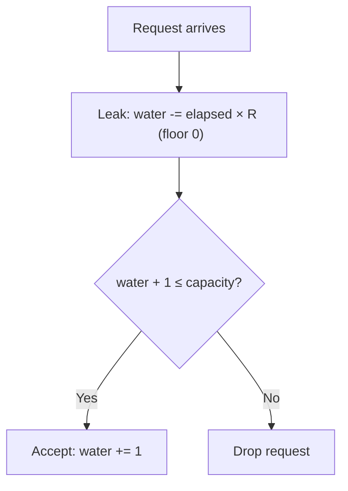
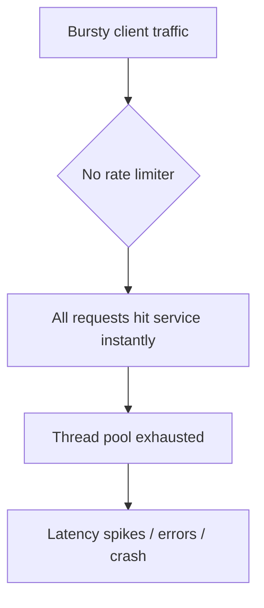
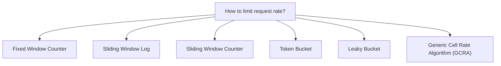
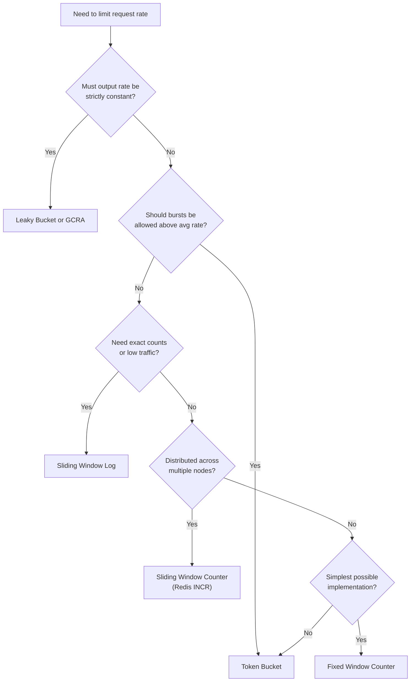

# Leaky Bucket in System Design

A reference on the **Leaky Bucket** algorithm: what it is, why it exists, when to use it, its
tradeoffs, and what to use instead.

---

## Table of Contents
1. [What Is the Leaky Bucket?](#1-what-is-the-leaky-bucket)
2. [What Is Its Purpose?](#2-what-is-its-purpose)
3. [Why Do We Use It?](#3-why-do-we-use-it)
4. [When Should We Use It?](#4-when-should-we-use-it)
5. [Tradeoffs](#5-tradeoffs)
6. [Advantages and Disadvantages](#6-advantages-and-disadvantages)
7. [Alternatives](#7-alternatives)
8. [Quick Decision Guide](#8-quick-decision-guide)
9. [Java Implementation](#9-java-implementation)
10. [Running the Project](#10-running-the-project)

---

## 1. What Is the Leaky Bucket?

The **Leaky Bucket** is a rate-limiting and traffic-shaping algorithm. Incoming requests are added
to a fixed-capacity bucket. The bucket continuously leaks (processes) requests at a constant rate.
If the bucket is full when a new request arrives, that request is dropped.

### The idea

```
Incoming Requests (bursty)
          │
          ▼
   ┌──────────────┐
   │    BUCKET    │  capacity = N  →  drop if full
   └──────┬───────┘
          │  leak rate = R req/s  (constant)
          ▼
   Outgoing Stream (smooth, always at rate R)
```

### Parameters

| Symbol | Meaning |
| :--- | :--- |
| `N` (capacity) | Maximum number of requests the bucket can hold at one time |
| `R` (leak rate) | Number of requests processed (leaked) per second — the output rate |
| `water` | Current number of queued requests in the bucket (0 ≤ water ≤ N) |

### The algorithm

For each arriving request:

1. Compute how much water has leaked since the last call: `leaked = elapsed_seconds × R`.
2. Subtract `leaked` from `water` (floor at 0).
3. If `water + 1 ≤ N` → **accept** the request, increment `water`.
4. Otherwise → **drop** the request.



### Worked example

`capacity = 3`, `leak rate = 2 req/s`.  
Five requests arrive instantly, then 1 second passes, then two more arrive.

| Event | Elapsed since last | Leaked | Water before | Action | Water after |
| :--- | :--- | :--- | :--- | :--- | :--- |
| Request 1 | 0 s | 0 | 0 | **ACCEPT** | 1 |
| Request 2 | ~0 s | ~0 | 1 | **ACCEPT** | 2 |
| Request 3 | ~0 s | ~0 | 2 | **ACCEPT** | 3 |
| Request 4 | ~0 s | ~0 | 3 | **DROP** (full) | 3 |
| Request 5 | ~0 s | ~0 | 3 | **DROP** (full) | 3 |
| — 1 second passes — | 1 s | 2 | 3 | — | 1 |
| Request 6 | 0 s | 0 | 1 | **ACCEPT** | 2 |
| Request 7 | ~0 s | ~0 | 2 | **ACCEPT** | 3 |

Requests 4 and 5 are dropped because the bucket was full. After 1 second of leaking at 2 req/s,
two slots free up and requests 6 and 7 are accepted.

---

## 2. What Is Its Purpose?

The purpose is to **enforce a maximum output rate and absorb short bursts**, so that a downstream
service always receives traffic at a predictable, constant pace.

It answers one question:

> "Should this request be accepted right now, or dropped because the system is already saturated?"

Every caller that knows the bucket's capacity and leak rate gets a consistent answer, with no
central coordinator needed beyond the shared bucket state.

---

## 3. Why Do We Use It?

### The problem without rate limiting

Without any control, a burst of requests hits the downstream system directly. A sudden spike
can exhaust connection pools, overwhelm databases, or cause cascading failures.



### Why a leaky bucket specifically

| Requirement | How the Leaky Bucket meets it |
| :--- | :--- |
| Smooth, predictable output | Output rate is exactly R, regardless of arrival pattern |
| Burst tolerance | Up to N requests can queue; short bursts are absorbed rather than immediately dropped |
| O(1) per request | Only one subtraction and one comparison; no sorted structures, no per-request queues |
| No clock dependency per request | Only the time of the last leak event is stored, not a timestamp per queued request |
| Simple to implement | About 20 lines of code with a single numeric state variable |

### Naive alternatives and why they fall short

| Naive approach | Problem |
| :--- | :--- |
| **No limiting** | Downstream service can be overwhelmed by any burst |
| **Hard cap (reject above N req/s)** | Resets every second boundary — can allow 2× the limit at the seam between windows |
| **Simple counter + sleep** | One thread per request, does not scale; blocking ties up resources |
| **Queue everything** | Unbounded queue causes unlimited latency growth; does not shed load |

---

## 4. When Should We Use It?

Use the Leaky Bucket when **traffic must exit at a constant rate and bursts must be smoothed,
not passed through**.

| Scenario | Why it fits |
| :--- | :--- |
| **Outbound API calls to a third-party service** | External APIs enforce strict per-second rate limits; the leaky bucket ensures you never exceed them, even during bursts |
| **Network egress shaping** | ISPs and cloud providers use leaky buckets to enforce a constant bit rate on an uplink |
| **Message queue producers** | Smooth a burst of events before writing to Kafka or SQS so consumers are not overwhelmed |
| **Microservice self-protection** | Shed excess load at the entry point before the request reaches the database |
| **Payment or SMS gateways** | Providers charge per-request penalties or throttle if you exceed a rate; smooth output prevents this |
| **Video / audio streaming** | Maintain a constant data rate to a client's buffer |

Use it especially when:
- The downstream system cannot handle sudden spikes and needs a steady input rate.
- Bursts are short and acceptable to queue; only sustained overload should drop requests.
- You want **traffic shaping** (smooth output), not just **traffic policing** (counting and rejecting).

### When you should not use it

| Situation | Better choice |
| :--- | :--- |
| You need to **allow short bursts** above the average rate | Token Bucket (burst up to the token reserve) |
| You need **per-user or per-key** limiting across many distributed nodes | Redis-backed sliding window or token bucket |
| You need **exact, fair throughput** per client with no queuing delay | Token Bucket with no queue |
| You need **rate limiting on reads** where the client can retry immediately | Sliding Window Counter |
| The rate varies over time (e.g. diurnal pattern) | Dynamic token bucket or adaptive limiter |
| You need to **count and report** how close you are to the limit | Sliding Window Log (stores per-request timestamps) |

---

## 5. Tradeoffs

The Leaky Bucket buys **smooth, predictable output**. It pays for it elsewhere.

| You gain | You give up |
| :--- | :--- |
| Constant output rate — downstream always sees traffic at rate R | **Burst penalty.** A sudden burst is absorbed up to N, but excess requests are dropped, not delayed |
| Simple O(1) state — one float, one timestamp | **No burst allowance beyond capacity.** Unlike Token Bucket, there is no accumulated credit for quiet periods |
| Predictable drop behaviour — overflow is immediate and deterministic | **Slightly stale water level.** Water is only updated lazily (on the next call), not on a background timer |
| No per-request timestamps needed | **Not distributed by default.** Shared state requires a lock or an external store (Redis) for multi-instance use |

### Key tradeoff: capacity vs. drop rate

| Larger capacity | Smaller capacity |
| :--- | :--- |
| More burst absorption — longer bursts are queued | Less burst absorption — requests drop sooner |
| Higher queuing latency for accepted requests | Lower queuing latency |
| More memory per bucket | Less memory per bucket |
| Downstream sees a longer ramp-up after a burst | Downstream sees a shorter ramp-up |

A common starting point is `capacity = leak_rate × expected_burst_duration_seconds`.
For a 5 req/s service that should absorb up to 2-second bursts, `capacity = 10`.

### Key tradeoff: Leaky Bucket vs. Token Bucket

| | Leaky Bucket | Token Bucket |
| :--- | :--- | :--- |
| Output | Fixed rate (smooth) | Burst up to token reserve, then average rate |
| Excess requests | Dropped immediately if bucket full | Accepted while tokens available; dropped when exhausted |
| Accumulated credit | None — quiet time does not help future requests | Yes — tokens accumulate during quiet periods |
| Best for | **Traffic shaping** — ISPs, streaming, smooth egress | **Rate limiting** — APIs, user quotas with burst tolerance |
| Complexity | Slightly simpler | Slightly more complex (token refill logic) |

---

## 6. Advantages and Disadvantages

### Advantages

1. **Constant output rate.** The downstream system always receives traffic at exactly R req/s, preventing overload from any arrival pattern.
2. **Burst absorption.** Short spikes are queued (up to capacity) rather than immediately rejected, smoothing transient load.
3. **O(1) time and space.** One float for water level, one timestamp. No queues, no sorted structures.
4. **Simple to implement.** The core logic is a subtraction, a max, and a comparison.
5. **Deterministic drops.** When the bucket is full, every new request is dropped. Behaviour is predictable and testable.
6. **Thread-safe by default.** A single `synchronized` block protects all state.
7. **No clock precision requirement.** Millisecond-resolution system clocks are sufficient.

### Disadvantages

1. **Hard drops under sustained overload.** Requests that arrive when the bucket is full are discarded immediately. There is no retry or back-pressure signal beyond the `false` return value.
2. **No burst credit.** Idle time does not accumulate future capacity. A system that is quiet for 10 seconds cannot then accept 10 seconds' worth of burst all at once (unlike Token Bucket).
3. **Single-process state.** The bucket lives in one JVM. Multi-instance deployments need a shared external store (e.g. Redis with an atomic INCR + TTL pattern) to enforce a global rate.
4. **Queuing latency.** Requests that fill the bucket are accepted but their processing is delayed by the time it takes for the water level to drop. This adds latency even for accepted requests.
5. **Sensitive to leak rate misconfiguration.** Too low a leak rate drops legitimate traffic; too high a rate provides no protection.
6. **No per-key limiting out of the box.** One bucket limits all traffic uniformly. Per-client or per-user limits require one bucket instance per key.

---

## 7. Alternatives

### Overview



### Comparison

| Approach | How it works | Strengths | Weaknesses | Used by |
| :--- | :--- | :--- | :--- | :--- |
| **Fixed Window Counter** | Count requests per discrete time window (e.g. per second). Reset at boundary | Trivially simple, O(1) | Allows 2× the limit at window boundaries (boundary burst) | Simple APIs, Redis INCR+EXPIRE |
| **Sliding Window Log** | Store a timestamp for every request; count those within the last T seconds | Exact, no boundary burst | O(requests in window) memory; expensive at high rates | Low-traffic, high-precision APIs |
| **Sliding Window Counter** | Blend current and previous fixed windows proportionally | Good accuracy, O(1) | Approximate (not exact) at boundaries | Cloudflare, Redis rate limiters |
| **Token Bucket** | Tokens accumulate at rate R up to a maximum. Each request consumes one token | Allows bursting up to token reserve; accumulated credit for idle periods | Slightly more complex; downstream still sees bursts | AWS API Gateway, Stripe, GitHub API |
| **Leaky Bucket** | Requests added to a fixed-capacity bucket; bucket drains at constant rate R | Smooth, constant output; simple O(1) state; deterministic drops | No burst credit; drops under sustained overload | Network egress, ISP traffic shaping, video streaming |
| **GCRA (Virtual Scheduling)** | Tracks a theoretical arrival time; each request must arrive no earlier than `TAT + 1/R` | Mathematically equivalent to Leaky Bucket; no water-level float needed | Harder to reason about intuitively | RFC 2697 (ATM networks), Nginx |

### Short guidance on each

- **Fixed Window:** correct choice when simplicity matters and 2× boundary bursts are acceptable.
- **Sliding Window Log:** choose when you need exact counts at low request rates and can afford per-request memory.
- **Sliding Window Counter:** a good default for distributed rate limiting — accurate, O(1), Redis-friendly.
- **Token Bucket:** choose when callers should be allowed short bursts and quiet periods should accumulate credit (most API rate limiters).
- **Leaky Bucket:** choose when the *output* rate must be strictly constant — network egress, video delivery, or calling a third-party API that enforces a hard per-second cap.
- **GCRA:** choose when you want leaky-bucket semantics without float arithmetic, especially in embedded or networking contexts.

---

## 8. Quick Decision Guide



### Summary

| Question | Answer |
| :--- | :--- |
| What is it? | A fixed-capacity bucket that drains at a constant rate; excess requests are dropped |
| Purpose | Enforce a maximum output rate and smooth bursty arrivals into a steady stream |
| Why use it? | Prevents bursty traffic from overloading a downstream system that expects a constant input rate |
| When to use it? | Outbound API calls to strict-rate-limited services, network egress, message queue ingestion, streaming |
| Main tradeoff | Smooth output and simple state, in exchange for no burst credit and immediate drops under sustained overload |
| Main weakness | Drops legitimate traffic when bucket is full; no accumulated capacity from idle periods |
| Main alternatives | Token Bucket (burst tolerance), Sliding Window Counter (distributed), GCRA (leaky bucket without floats) |

---

## 9. Java Implementation

Project layout (Java 17, Maven, no runtime dependencies):

```
Leaky-Bucket/
|-- pom.xml
`-- src
    |-- main/java/com/example/leakybucket/
    |   |-- LeakyBucket.java   # the algorithm: tryConsume, getCurrentWater, stats
    |   `-- Main.java          # demo, 2 scenarios
    `-- test/java/com/example/leakybucket/
        `-- LeakyBucketTest.java
```

### The algorithm in code

```java
public synchronized boolean tryConsume() {
    leak();                              // 1. drain water proportional to elapsed time
    if (currentWater + 1 <= capacity) { // 2. is there room?
        currentWater += 1;
        totalAccepted++;
        return true;                     //    yes → accept
    }
    totalDropped++;
    return false;                        //    no  → drop
}

private void leak() {
    long nowMs = now();
    double elapsedSeconds = (nowMs - lastLeakTimestampMs) / 1000.0;
    double leaked = elapsedSeconds * leakRatePerSecond;
    currentWater = Math.max(0, currentWater - leaked); // floor at 0
    lastLeakTimestampMs = nowMs;
}
```

- **Update is O(1).** One subtraction, one max, one comparison per request.
- **Lazy leak.** Water is only subtracted when `tryConsume()` or `getCurrentWater()` is called. There is no background thread.
- **`now()` is protected.** The method is `protected`, not `private`, so the test subclass can override it to inject a fake clock without any mocking framework.
- **Thread safety.** `tryConsume()`, `getCurrentWater()`, `getTotalAccepted()`, and `getTotalDropped()` are all `synchronized`. The `leak()` private method must be called while the monitor is held, which is always the case here.
- **Stats.** `totalAccepted` and `totalDropped` are counters that never reset, useful for monitoring dashboards or logging.

### Controllable-clock test subclass

```java
static class TestableLeakyBucket extends LeakyBucket {
    private long fakeTimeMs;

    TestableLeakyBucket(int capacity, double leakRate, long startMs) {
        super(capacity, leakRate);
        this.fakeTimeMs = startMs;
    }

    void advanceTime(long deltaMs) { fakeTimeMs += deltaMs; }

    @Override
    protected long now() { return fakeTimeMs; }
}
```

This lets every time-dependent test run **instantly** without any real `Thread.sleep` calls. The
virtual clock advances only when the test explicitly calls `advanceTime()`.

### Results from the demo

**Scenario A — burst of 15 requests, capacity = 10, leak rate = 5 req/s:**

```
--- Scenario A: Burst of 15 requests (capacity=10, leak=5/s) ---
  Request  1 → ACCEPTED  (water=1.0)
  Request  2 → ACCEPTED  (water=2.0)
  Request  3 → ACCEPTED  (water=3.0)
  Request  4 → ACCEPTED  (water=4.0)
  Request  5 → ACCEPTED  (water=5.0)
  Request  6 → ACCEPTED  (water=6.0)
  Request  7 → ACCEPTED  (water=7.0)
  Request  8 → ACCEPTED  (water=8.0)
  Request  9 → ACCEPTED  (water=9.0)
  Request 10 → ACCEPTED  (water=10.0)
  Request 11 → DROPPED   (water=10.0)
  Request 12 → DROPPED   (water=10.0)
  Request 13 → DROPPED   (water=10.0)
  Request 14 → DROPPED   (water=10.0)
  Request 15 → DROPPED   (water=10.0)

Total accepted: 10 | Total dropped: 5
```

Requests 1–10 fill the bucket. Requests 11–15 arrive while the bucket is still full (the leak
has had no time to drain it) and are dropped immediately.

**Scenario B — steady arrival at ~3.3 req/s (one every 300 ms), capacity = 10, leak rate = 5 req/s:**

```
--- Scenario B: Steady rate ~3.3 req/s (capacity=10, leak=5/s) ---
  Request  1 → ACCEPTED  (water=1.0)
  Request  2 → ACCEPTED  (water=0.5)
  Request  3 → ACCEPTED  (water=0.0)
  ...
  Request 10 → ACCEPTED  (water=0.0)

Total accepted: 10 | Total dropped: 0
```

Arrival rate (3.3 req/s) < leak rate (5 req/s), so the bucket drains faster than it fills. The
water level stays near zero and every request is accepted.

### What the tests check

[`LeakyBucketTest`](src/test/java/com/example/leakybucket/LeakyBucketTest.java) has **14 tests**:

- **Constructor validation** — zero capacity, negative leak rate, and zero leak rate are all rejected with `IllegalArgumentException`.
- **Acceptance up to capacity** — exactly N requests are accepted on an empty bucket with no time passing.
- **Drop when full** — the (N+1)th request is dropped when the bucket is at capacity.
- **Single request into empty bucket** — baseline: an empty bucket always accepts.
- **Water decreases after time passes** — advance 1 second at 2 req/s; water drops by exactly 2.
- **Water floors at zero** — advance 10 seconds with 1 request queued; water never goes negative.
- **Accepts again after leaking** — fill a bucket of 3 at 3 req/s, advance 1 second, one more request is accepted.
- **Partial leak allows partial refill** — advance 500 ms at 2 req/s on a full bucket of 4; exactly 1 slot frees up.
- **Stats tracking** — accepted and dropped counters are correct after a mixed sequence.
- **Metadata accessors** — `getCapacity()` and `getLeakRatePerSecond()` return the configured values.
- **`toString` contains key fields** — capacity and leak rate appear in the string representation.

---

## 10. Running the Project

Requirements: JDK 17+ and Maven. No Docker or network services needed.

```bash
cd Leaky-Bucket

mvn test                 # 14 unit tests
mvn compile exec:java    # run the demo (Main — two scenarios)
```
