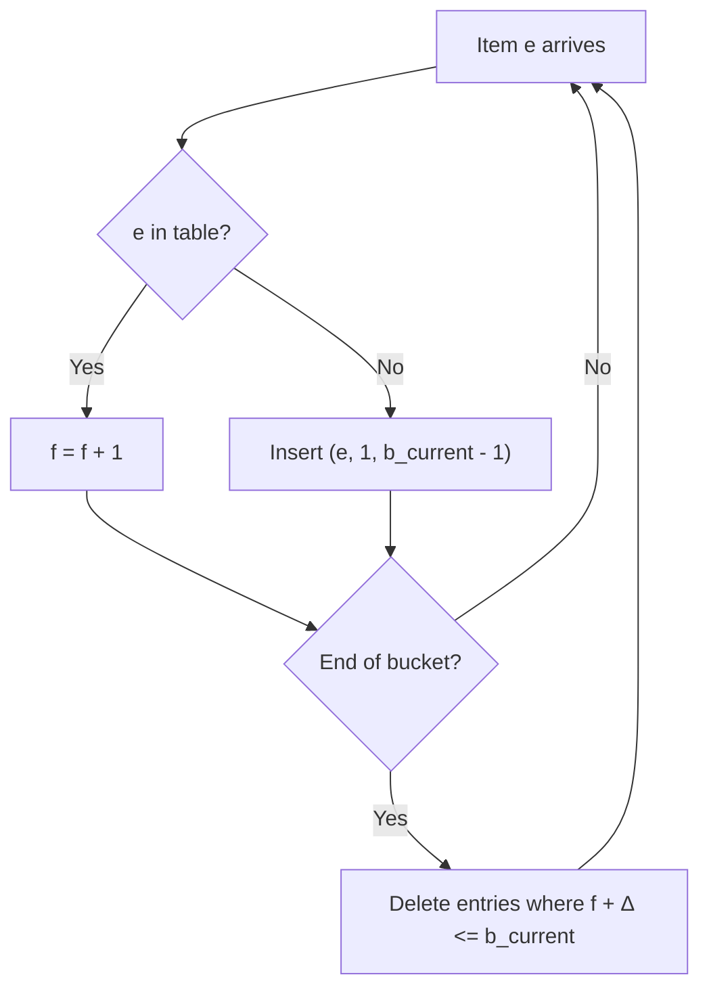
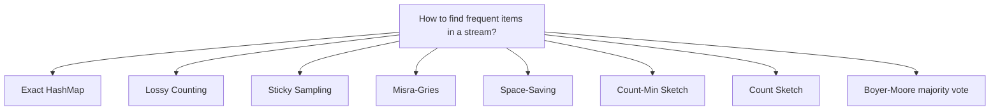
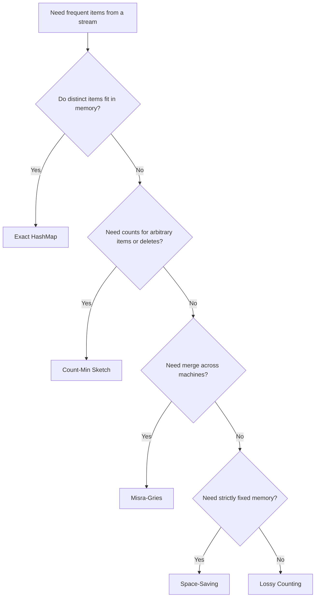

# Lossy Counting in System Design

A reference on **Lossy Counting**: what it is, why it exists, when to use it, its tradeoffs,
and what to use instead.

---

## Table of Contents
1. [What Is Lossy Counting?](#1-what-is-lossy-counting)
2. [What Is Its Purpose?](#2-what-is-its-purpose)
3. [Why Do We Use It?](#3-why-do-we-use-it)
4. [When Should We Use It?](#4-when-should-we-use-it)
5. [Tradeoffs](#5-tradeoffs)
6. [Advantages and Disadvantages](#6-advantages-and-disadvantages)
7. [Alternatives](#7-alternatives)
8. [Quick Decision Guide](#8-quick-decision-guide)

---

## 1. What Is Lossy Counting?

**Lossy Counting** is a deterministic algorithm that finds the **frequent items** (heavy hitters)
in a data stream using a small, bounded amount of memory. It was introduced by Manku and Motwani
(2002). Instead of keeping a counter for every distinct item, it keeps counters only for items that
look frequent, and periodically **drops** the ones that are not. The counts are therefore
approximate, but with a guaranteed error bound.

### Parameters

| Symbol | Meaning |
| :--- | :--- |
| `N` | Number of items seen so far in the stream |
| `s` | **Support threshold.** You want items whose frequency is at least `s * N` |
| `ε` (epsilon) | **Error tolerance**, with `ε < s`. Typically about `s / 10` |
| `w = ceil(1/ε)` | **Bucket width.** The stream is split into buckets of `w` items |
| `b_current = ceil(N / w)` | Id of the current bucket |

### The algorithm

Keep a table of entries `(item, f, Δ)`:
- `f` is the count of the item since it was inserted into the table.
- `Δ` is the **maximum possible undercount**: how many occurrences might have been missed before the item was inserted. It is set to `b_current - 1`.

For each arriving item `e`:

1. If `e` is in the table, increment its `f`.
2. Otherwise insert `(e, 1, b_current - 1)`.
3. At the end of every bucket (when `N` is a multiple of `w`), **delete every entry where `f + Δ <= b_current`**.

To report frequent items, return every entry with `f >= (s - ε) * N`.

### Worked example

`ε = 0.25`, so bucket width `w = 4`. Stream: `a a b c | a d a b`

| Point in stream | Table `(item, f, Δ)` | Action |
| :--- | :--- | :--- |
| After `a a b c` (bucket 1 full) | `a(2,0) b(1,0) c(1,0)` | Prune where `f+Δ <= 1`: `b` and `c` are deleted |
| Table after pruning | `a(2,0)` | |
| After `a d a b` (bucket 2 full) | `a(4,0) d(1,1) b(1,1)` | `d` and `b` were inserted with `Δ = 1`. Prune where `f+Δ <= 2`: both are deleted |
| Table after pruning | `a(4,0)` | `a` is the only frequent item. Its estimate 4 equals the true count 4 |

Rare items come and go cheaply. Genuinely frequent items survive every prune.

### Guarantees

For any item with true frequency `f_true` after `N` items:

| Guarantee | Meaning |
| :--- | :--- |
| `f_true - ε * N <= f_est <= f_true` | The estimate **never overcounts** and undercounts by at most `ε * N` |
| **No false negatives** | Every item with `f_true >= s * N` is reported |
| **Bounded false positives** | No item with `f_true < (s - ε) * N` is reported |
| **Space** | At most `(1/ε) * log(ε * N)` entries in the worst case |

---

## 2. What Is Its Purpose?

The purpose is to **answer "which items are frequent?" over a stream that is too large to count
exactly**, using memory that does not grow with the number of distinct items.

It answers one question in a single pass:

> "Which items have appeared in at least `s` percent of everything seen so far?"

It reads each item once, never stores the stream, and gives a bounded-error answer at any time.

---

## 3. Why Do We Use It?

### The problem with exact counting

The obvious approach is a `HashMap<item, count>`. Memory grows with the number of **distinct**
items, and in real streams that number is huge and unbounded.

| Stream | Distinct items |
| :--- | :--- |
| Search queries | Billions of unique strings |
| Network flows | Millions of source/destination pairs per minute |
| Log lines or URLs | Effectively unbounded |
| Click or event IDs | Grows forever |

Most of those items appear once or twice and are of no interest. Storing a counter for each one
wastes almost all of the memory on noise.

| Scheme | Memory | Result |
| :--- | :--- | :--- |
| Exact `HashMap` | O(distinct items), unbounded | Exact counts, but may run out of memory |
| Lossy Counting | O((1/ε) log(εN)) | Approximate counts with a known error bound |

### Why that matters

- **Single pass.** The stream cannot be replayed or stored, so the algorithm must work as data flows by.
- **Bounded memory.** Memory depends on `ε`, which you choose, not on how many distinct items arrive.
- **Known error.** Unlike an ad-hoc sample, the error is guaranteed, not just probable.
- **No false negatives.** Anything truly frequent is reported. You may get a few extra borderline items but never miss a heavy hitter.
- **Deterministic.** There is no randomness, so results are reproducible for the same input.

---

## 4. When Should We Use It?

Use Lossy Counting when you need **frequent items from a large or unbounded stream** and an
approximate answer is acceptable.

| Scenario | Why it fits |
| :--- | :--- |
| **Network monitoring** (heavy-hitter flows, DDoS source detection) | Millions of flows, only the top talkers matter |
| **Trending queries and hashtags** | Find terms above a share of traffic without counting every term |
| **Frequent itemset mining** (the original motivation) | Count candidate itemsets in a transaction stream |
| **Log and event analytics** | Most common error codes, URLs or users in a stream |
| **Ad and click analytics** | Most frequent campaigns, domains or IPs |
| **Rate limiting and abuse detection** | Spot clients responsible for a large share of requests |
| **Cache admission and hot-key detection** | Identify keys frequent enough to be worth caching |

Use it especially when:
- The stream is too large to store or replay.
- Distinct items far outnumber the frequent ones.
- A relative error of `ε * N` is acceptable.
- You need a guarantee of no missed heavy hitters.

### When you should not use it

| Situation | Better choice |
| :--- | :--- |
| Memory is **strictly fixed** and must not vary | Space-Saving or Misra-Gries (fixed `k` counters) |
| You need exact counts | Exact `HashMap`, or a database |
| The number of distinct items is small | Exact `HashMap` is simpler and exact |
| You need the count of **any** item, not just frequent ones | Count-Min Sketch |
| You need to **delete** or decrement items | Count-Min Sketch (supports it) |
| You need the number of **distinct** items | HyperLogLog |
| You need quantiles or percentiles | t-digest, GK sketch |
| The stream is distributed over many machines and must be merged | Mergeable summaries (Misra-Gries, Count-Min) |

---

## 5. Tradeoffs

Lossy Counting buys **bounded memory with a guaranteed error**. It pays for it elsewhere.

| You gain | You give up |
| :--- | :--- |
| Memory independent of distinct item count | **Exact counts.** Estimates can be too low by up to `ε * N` |
| No false negatives for items above `s * N` | **No false-positive guarantee at the margin.** Items between `(s - ε) * N` and `s * N` may be reported |
| Single pass, one update per item | **Pruning cost.** A scan of the table at every bucket boundary |
| Deterministic, reproducible results | **Space not fixed.** Table size varies and grows slowly (logarithmically) with `N` |
| Simple to implement | **Errors grow with the stream.** `ε * N` increases as `N` grows |

### Key tradeoff: choice of ε

| Smaller ε | Larger ε |
| :--- | :--- |
| Tighter error bound, more accurate counts | Looser bound, less accurate counts |
| Fewer false positives | More false positives near the threshold |
| More memory (about `1/ε` entries or more) | Less memory |
| Wider buckets, so pruning runs less often | Narrower buckets, so pruning runs more often |

A common rule of thumb is `ε = s / 10`. For `s = 1%`, use `ε = 0.1%`, which means a bucket
width of 1,000 and roughly a few thousand entries in practice.

### Key tradeoff: memory vs. accuracy vs. guarantee

| Property | Lossy Counting | Space-Saving / Misra-Gries | Count-Min Sketch |
| :--- | :--- | :--- | :--- |
| Memory | Grows slowly, `log(εN)` | **Fixed** | **Fixed** |
| Error direction | Underestimates | Over (Space-Saving) or under (Misra-Gries) | Overestimates |
| Guarantee | Deterministic | Deterministic | **Probabilistic** |
| Lists the frequent items | Yes | Yes | Needs a separate heap or list |

You choose which property matters most.

---

## 6. Advantages and Disadvantages

### Advantages

1. **Bounded memory.** Space depends on `ε`, not on the number of distinct items.
2. **Guaranteed error.** Estimates are within `ε * N` of the truth, and never above it.
3. **No false negatives.** Every item above the support threshold is reported.
4. **Single pass.** Each item is read once and the stream is never stored.
5. **Deterministic.** No random numbers and no hash functions, so runs are reproducible.
6. **Simple.** The algorithm is a map, a counter and a periodic prune.
7. **Works in practice better than the worst case.** Real skewed streams use far less memory than the theoretical bound.
8. **Anytime answers.** You can query the frequent items at any point in the stream.

### Disadvantages

1. **Approximate counts.** Every estimate may be low by up to `ε * N`.
2. **False positives.** Items slightly under the threshold can appear in the output.
3. **Space is not fixed.** The table size fluctuates and the worst-case bound grows with `log N`. Peak memory is harder to plan for than with a fixed-size summary.
4. **Prune pauses.** A full table scan every `w` items can cause latency spikes if the table is large.
5. **Error grows over time.** `ε * N` keeps increasing, so absolute error in a never-ending stream grows even though relative error stays fixed.
6. **Only frequent items.** Counts for infrequent items are discarded and cannot be recovered.
7. **Insert-only.** It does not support deleting or decrementing counts.
8. **Not easily mergeable.** Combining summaries from several machines is less straightforward than with Misra-Gries or Count-Min.
9. **Often beaten in practice.** Space-Saving typically uses less memory for the same accuracy.

---

## 7. Alternatives

### Overview

### Comparison

| Approach | How it works | Strengths | Weaknesses | Used by |
| :--- | :--- | :--- | :--- | :--- |
| **Exact HashMap** | One counter per distinct item | Exact, trivial | Memory grows without bound | Small data, batch jobs |
| **Sticky Sampling** | Sample new items with decreasing probability, keep counts for sampled items | Space independent of `N` in expectation | **Probabilistic** guarantee, uses randomness | Streaming research, itemset mining |
| **Misra-Gries (Frequent)** | Keep `k` counters; when full, decrement all | Fixed space, deterministic, **mergeable** | Underestimates, error `N/k` | Distributed heavy hitters, Spark and Flink summaries |
| **Space-Saving** | Keep `k` counters; replace the smallest with the new item | Fixed space, deterministic, usually most accurate in practice | Overestimates, needs a structure for the minimum | Top-K systems, network monitors |
| **Count-Min Sketch** | 2D array of counters updated by several hash functions | Fixed space, any item can be queried, mergeable, supports deletes | **Probabilistic**, only overestimates, needs a heap to list top items | Redis (RedisBloom), Apache DataSketches, databases |
| **Count Sketch** | Like Count-Min, with signed counters | Unbiased estimates, better for skewed data | Larger, more complex | Machine learning, large-scale analytics |
| **Boyer-Moore majority vote** | Single counter and candidate | One counter, trivial | Finds only an item above 50% | Majority detection |

### Short guidance on each

- **Exact HashMap:** correct choice when distinct items fit in memory.
- **Sticky Sampling:** same goal as Lossy Counting, but randomized. Prefer Lossy Counting when you want deterministic output.
- **Misra-Gries:** choose when you need a fixed number of counters or must merge summaries from many nodes.
- **Space-Saving:** often the best default for top-K. Fixed memory and strong accuracy.
- **Count-Min Sketch:** choose when you need counts for arbitrary items, deletions, or merging, and can accept probabilistic error.
- **Count Sketch:** choose when bias matters, for example when you need unbiased estimates.
- **Boyer-Moore:** choose only to find a strict majority element.

---

## 8. Quick Decision Guide

### Summary

| Question | Answer |
| :--- | :--- |
| What is it? | A one-pass algorithm that keeps counters only for items that look frequent and prunes the rest each bucket |
| Purpose | Find frequent items in a stream with bounded memory and a guaranteed error |
| Why use it? | Exact counting needs memory proportional to distinct items, which is unbounded in real streams |
| When to use it? | Large or unbounded streams where approximate heavy hitters are enough: network flows, trending terms, logs, clicks |
| Main tradeoff | Bounded memory and no missed heavy hitters, in exchange for undercounted values and non-fixed space |
| Main weakness | Approximate counts, false positives near the threshold, space grows with `log N`, hard to merge |
| Main alternatives | Misra-Gries, Space-Saving, Count-Min Sketch, Sticky Sampling, exact HashMap |

---

## References

- G. S. Manku and R. Motwani. *Approximate Frequency Counts over Data Streams.* VLDB 2002.
- J. Misra and D. Gries. *Finding Repeated Elements.* 1982.
- A. Metwally, D. Agrawal and A. El Abbadi. *Efficient Computation of Frequent and Top-k Elements in Data Streams.* ICDT 2005.
- G. Cormode and S. Muthukrishnan. *An Improved Data Stream Summary: The Count-Min Sketch and its Applications.* 2005.
