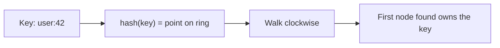
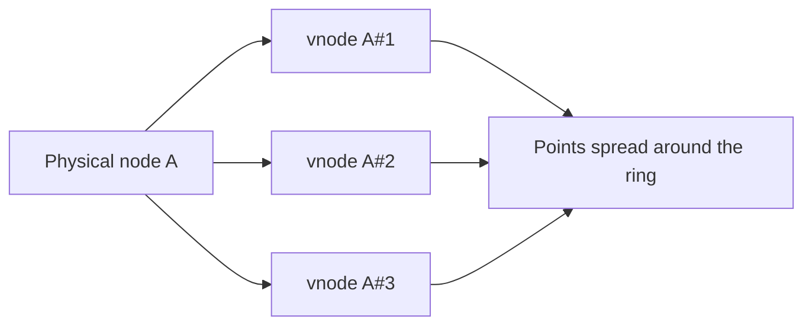
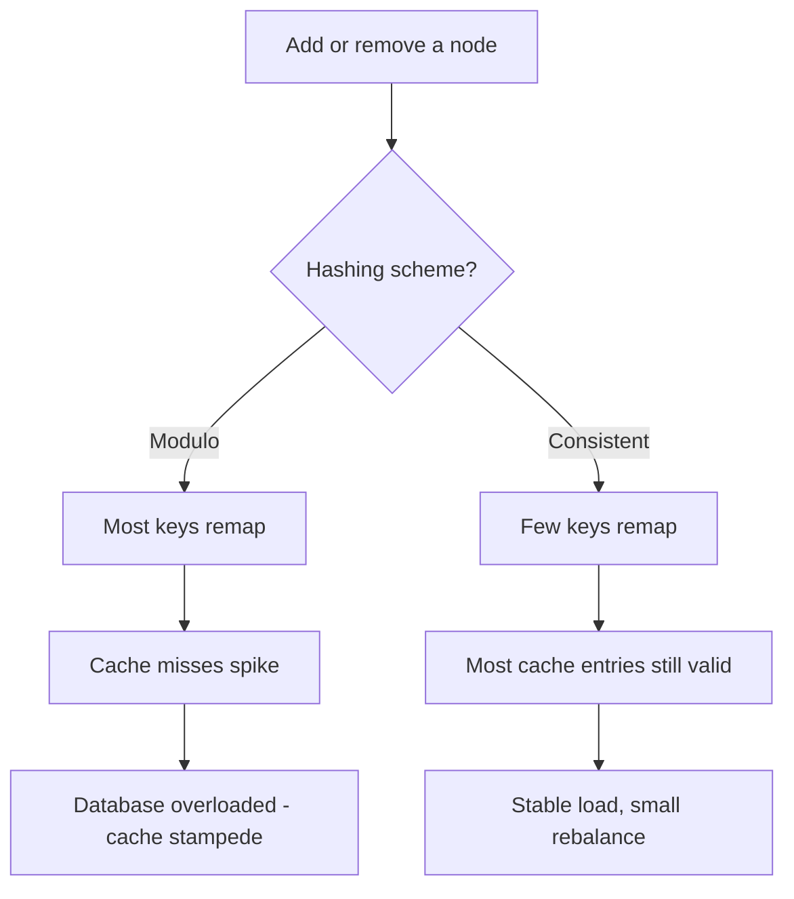
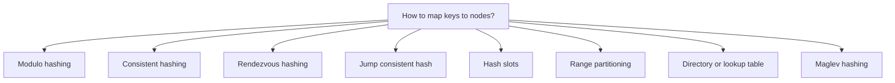
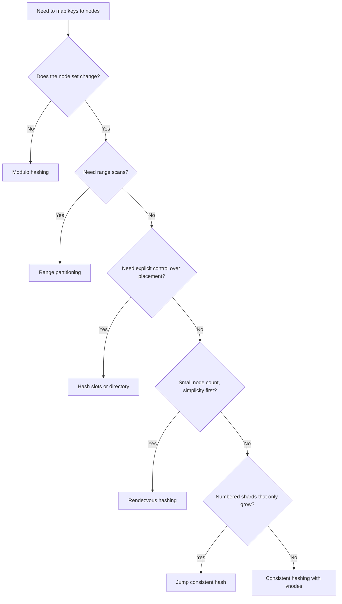

# Consistent Hashing in System Design

A reference on **consistent hashing**: what it is, why it exists, when to use it, its tradeoffs,
and what to use instead.

---

## Table of Contents
1. [What Is Consistent Hashing?](#1-what-is-consistent-hashing)
2. [What Is Its Purpose?](#2-what-is-its-purpose)
3. [Why Do We Use It?](#3-why-do-we-use-it)
4. [When Should We Use It?](#4-when-should-we-use-it)
5. [Tradeoffs](#5-tradeoffs)
6. [Advantages and Disadvantages](#6-advantages-and-disadvantages)
7. [Alternatives](#7-alternatives)
8. [Quick Decision Guide](#8-quick-decision-guide)

---

## 1. What Is Consistent Hashing?

**Consistent hashing** is a way to decide which node (server, cache, shard) owns a given key,
so that adding or removing a node moves only a **small fraction** of the keys.

### The idea

1. Hash both **nodes** and **keys** onto the same circular space, called the **hash ring**
   (for example 0 to 2^32 - 1, where the end wraps around to the start).
2. To find the owner of a key, hash the key to a point on the ring, then walk **clockwise**
   until you reach the first node. That node owns the key.



```
                 0 / 2^32
                    |
          Node A  ──●──
         /                \
   key k1 ●                ● key k2
       /                      \
  Node D ●                      ● Node B
       \                      /
         key k4 ●          ● key k3
                \        /
                  ● Node C

   k1 -> clockwise -> Node A      k2 -> clockwise -> Node B
   k3 -> clockwise -> Node C      k4 -> clockwise -> Node D
```

### What happens when the cluster changes

| Event | Effect |
| :--- | :--- |
| A node is **added** | It takes over only the keys between itself and the previous node on the ring. Every other key stays where it was |
| A node is **removed** | Only its own keys move, to the next node clockwise. Every other key stays where it was |

### Virtual nodes (vnodes)

With one point per node, nodes land unevenly on the ring and some own much larger arcs than others.
The fix is to place each physical node on the ring **many times** (often 100 to 256 points), using
names like `nodeA#1`, `nodeA#2`, and so on.



Virtual nodes give:
- **Even load.** Many small arcs per node average out.
- **Even recovery.** When a node leaves, its keys spread across many remaining nodes, not onto one unlucky neighbour.
- **Weighting.** A bigger machine gets more vnodes than a smaller one.

---

## 2. What Is Its Purpose?

The purpose is to **distribute keys across a changing set of nodes with minimal data movement**.

It answers one question, quickly and without a central coordinator:

> "Which node is responsible for this key right now?"

Every client that knows the node list and the hash function gets the same answer, with no lookup service.

---

## 3. Why Do We Use It?

### The problem with simple modulo hashing

The obvious approach is `node = hash(key) % N`. It breaks when `N` changes.

Going from 4 nodes to 5 changes `hash(key) % 4` into `hash(key) % 5` for almost every key:

| Scheme | Keys that move when going from 4 to 5 nodes |
| :--- | :--- |
| Modulo hashing | About **80%** (a key stays only when both remainders match, roughly 1 in 5) |
| Consistent hashing | About **20%** (only the keys the new node takes over, roughly 1 in 5) |

In general, adding one node to N nodes moves about `N/(N+1)` of the keys with modulo, and about
`1/(N+1)` with consistent hashing.

### Why that matters



- **Caches:** remapped keys are cache misses. A mass remap sends a flood of reads to the database at the worst moment.
- **Sharded databases and stores:** remapped keys mean physically moving data between machines. Moving 80% of it is slow and risky.
- **Scaling and failure:** nodes are added for growth and removed on failure. Both should be routine, not events that disturb the whole cluster.
- **No coordinator:** the placement is computed from the key, so there is no central lookup table that can become a bottleneck or a single point of failure.

---

## 4. When Should We Use It?

Use consistent hashing when **keys are spread across nodes that change over time** and moving data is costly.

| Scenario | Why it fits |
| :--- | :--- |
| **Distributed caches** (Memcached or Redis fleets with client-side sharding) | Scaling the cache tier should not flush most of it |
| **Partitioned databases** (Dynamo-style stores such as Cassandra and Riak) | Adding a node should move only a slice of the data |
| **CDN and edge caches** | Route a URL to the same edge server so its content stays cached |
| **Load balancing with affinity** | Keep a user, session or tenant on the same backend |
| **Sharded message and stream processing** | Keep a key's events on the same worker so its state stays local |
| **Distributed file and object stores** | Place chunks or objects across storage nodes |
| **Service discovery with sticky routing** | Route consistently without a central router |

Use it especially when:
- The node count changes (autoscaling, failures, deployments).
- The data set is large, so a full reshuffle is expensive.
- Cache hit rate must survive topology changes.
- There is no central coordinator you want to depend on.

### When you should not use it

| Situation | Better choice |
| :--- | :--- |
| The node set is fixed and never changes | Plain modulo is simpler |
| You have a single node or a handful of nodes that rarely change | Not worth the complexity |
| Stateless load balancing where any node can serve any request | Round robin, least connections |
| You need range queries across keys (scans, ordered reads) | Range partitioning |
| You need strict, evenly bounded load per node | Bounded-load variant, hash slots or a directory |
| Hot keys dominate the load | Hashing cannot fix this; see the tradeoffs section |

---

## 5. Tradeoffs

Consistent hashing buys **stability under change**. It pays for it elsewhere.

| You gain | You give up |
| :--- | :--- |
| Few keys move on add or remove | **Perfectly even load.** Distribution is statistical, not exact |
| No central lookup table | **Clients must agree on the ring.** Every client needs the same node list and hash function, so membership has to be distributed reliably |
| Fast lookup, O(log N) with a sorted ring | **Memory and complexity.** The ring holds nodes times vnodes entries, and must be kept in sync |
| Smooth scaling | **No ordering.** Hashed keys lose their natural order, so range scans touch many nodes |
| Failure only affects one node's keys | **Cascading risk.** When a node dies, its whole load lands on its clockwise neighbours (reduced, but not removed, by vnodes) |

### Key tradeoff: number of virtual nodes

| More vnodes per node | Fewer vnodes per node |
| :--- | :--- |
| Smoother, more even load | Uneven load; some nodes get much more than their share |
| Larger ring, more memory, slower to rebuild | Smaller, faster ring |
| Failure load spreads thinly across many nodes | Failure load lands on one or two neighbours |
| More metadata to gossip and keep consistent | Less metadata |

A common range is 100 to 256 vnodes per node. The right number depends on cluster size and how
even the load needs to be.

### Key tradeoff: data movement vs. balance

Consistent hashing optimizes **minimal movement**. Other schemes optimize **balance** (for example,
bounded-load variants) or **speed and memory**. You choose which property matters most.

---

## 6. Advantages and Disadvantages

### Advantages

1. **Minimal remapping.** Adding or removing a node moves about 1/N of the keys, not nearly all of them.
2. **Scales horizontally.** Add capacity without a big-bang rebalance or downtime.
3. **Graceful failure handling.** One node leaving affects only the keys it owned.
4. **Decentralized.** Any client can compute placement from the key. No central router is needed.
5. **Supports heterogeneous nodes.** Give powerful machines more vnodes.
6. **Works well with replication.** Store a key on the next R distinct nodes clockwise to get R replicas (the approach used by Dynamo-style systems).
7. **Preserves cache locality.** Most cached entries remain valid through a topology change.

### Disadvantages

1. **Uneven distribution without vnodes.** Few points per node means badly skewed arcs; the most loaded node can carry several times the average.
2. **Still statistically uneven with vnodes.** It improves with more vnodes but is never perfectly flat.
3. **Hot keys are not solved.** A single very popular key always lands on one node, however good the hash is.
4. **Membership must be consistent.** If clients disagree about which nodes exist, they disagree about where keys live. That causes misses and misrouted writes.
5. **Cascading load on failure.** A failed node's load shifts to its neighbours, which can push them over capacity.
6. **More complex than modulo.** Needs a sorted structure, vnode management and a good hash function.
7. **No range queries.** Hashing destroys key ordering.
8. **Data still has to move.** Fewer keys move, but they still need to be migrated or rewarmed when topology changes.
9. **Ring memory and lookup cost.** Thousands of vnodes make the ring larger, though lookup stays logarithmic.

---

## 7. Alternatives

### Overview



### Comparison

| Approach | How it works | Strengths | Weaknesses | Used by |
| :--- | :--- | :--- | :--- | :--- |
| **Modulo hashing** | `hash(key) % N` | Trivial, perfectly even, very fast | Nearly everything moves when N changes | Fixed-size clusters, in-process sharding |
| **Rendezvous (HRW) hashing** | Score every node for the key, pick the highest | Simple, even, minimal movement, no ring or vnodes | O(N) per lookup | Load balancers, small to mid-size clusters |
| **Jump consistent hash** | Compute a bucket number from key and bucket count using a tiny function | Very fast, no memory, near-perfect balance | Buckets must be numbered 0 to N-1; can only add or remove the **last** bucket; no weights or arbitrary node removal | Sharding with numbered shards |
| **Hash slots** (fixed slot count) | Hash the key to one of a fixed number of slots; assign slots to nodes | Even, explicit control, easy to move slots one at a time | Needs a slot-to-node map to be stored and shared | Redis Cluster (16,384 slots) |
| **Range partitioning** | Split the key space into ordered ranges, one per node | Efficient range scans, ordered data | Hot ranges, needs rebalancing and a range map | Bigtable, HBase, CockroachDB, Spanner |
| **Directory / lookup table** | A service stores explicit key-to-node mappings | Total control, can move any key, handles hot keys | A central dependency; the map itself must scale and stay available | Many sharded databases, metadata services |
| **Maglev hashing** | Build a fixed lookup table from per-node permutations | Very fast O(1) lookups, good balance, minimal disruption | Table must be rebuilt on change; small table-size tradeoffs | Google Maglev load balancer, Envoy |
| **Consistent hashing with bounded loads** | Consistent hashing plus a cap on per-node load; overflow goes to the next node | Controls overload, keeps most locality | Extra logic, some extra movement | Large-scale load balancing |

### Short guidance on each

- **Modulo hashing:** correct choice when the node count truly never changes.
- **Rendezvous hashing:** often simpler than a ring and naturally balanced. The O(N) cost is fine when N is small (tens or low hundreds of nodes).
- **Jump consistent hash:** best when shards are numbered and only grow at the end, and you want almost no memory and no ring.
- **Hash slots:** a very practical middle ground. You get the stability of a ring with explicit, inspectable ownership, and you move data one slot at a time.
- **Range partitioning:** pick this when you need ordered scans or range queries.
- **Directory:** pick this when you need per-key control, or have hot keys you want to place deliberately.
- **Maglev:** pick this for very high-throughput load balancers where lookup speed matters most.
- **Bounded loads:** pick this when plain consistent hashing overloads individual nodes.

---

## 8. Quick Decision Guide



### Summary

| Question | Answer |
| :--- | :--- |
| What is it? | A key-to-node mapping on a hash ring that survives node changes |
| Purpose | Minimal key movement when nodes join or leave, with no central coordinator |
| Why use it? | Modulo hashing remaps most keys on change, which wrecks caches and forces huge data moves |
| When to use it? | Dynamic clusters: caches, partitioned stores, CDNs, sticky load balancing |
| Main tradeoff | Stability and decentralization, in exchange for uneven load and membership coordination |
| Main weakness | Imperfect balance, hot keys, cascading load on failure, no range queries |
| Main alternatives | Rendezvous, jump hash, hash slots, range partitioning, directory, Maglev |
