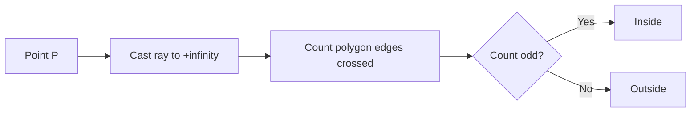
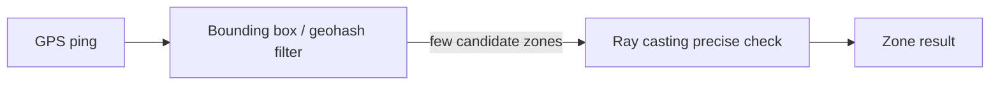
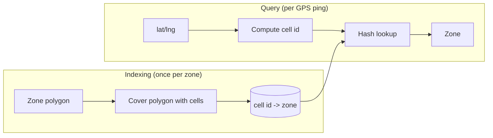

# Ray Casting in System Design

A reference on the **ray casting algorithm** for point-in-polygon tests — what it is,
why it is used, its tradeoffs, and where it should (and should not) be used.

---

## Table of Contents
1. [Overview](#1-overview)
2. [How It Works](#2-how-it-works)
3. [Why It Is Used](#3-why-it-is-used)
4. [Tradeoffs](#4-tradeoffs)
5. [Disadvantages and Pitfalls](#5-disadvantages-and-pitfalls)
6. [When to Use / When Not to Use](#6-when-to-use--when-not-to-use)
7. [Typical System Design Usage](#7-typical-system-design-usage)
8. [Ray Casting in Graphics](#8-ray-casting-in-graphics)
9. [Java Implementation](#9-java-implementation)
10. [Libraries You Can Use Instead](#10-libraries-you-can-use-instead)
11. [Google S2 and Uber H3 (Cell-Based Indexes)](#11-google-s2-and-uber-h3-cell-based-indexes)
12. [PostGIS and GeoTools](#12-postgis-and-geotools)
13. [Running the Project](#13-running-the-project)

---

## 1. Overview

**Ray casting** answers one question: *is a point inside or outside a polygon?*

## 2. How It Works

1. Draw a ray from the point in a fixed direction (usually horizontal, to the right).
2. Count how many polygon edges the ray crosses.
3. **Odd** count → **inside**. **Even** count → **outside**.

Each crossing flips the state between outside and inside. A ray that starts outside must
cross an even number of edges to end up outside at infinity.



```
        ┌───────────┐
   P1 ──┼──────────►│ ──────►      P1 outside: 2 crossings (even)
        │     P2 ───┼──────►       P2 inside:  1 crossing  (odd)
        └───────────┘
```

### Pseudocode

```
inside = false
for each edge (A, B):
    if (A.y > P.y) != (B.y > P.y)
       and P.x < (B.x - A.x) * (P.y - A.y) / (B.y - A.y) + A.x:
        inside = !inside
return inside
```

The half-open comparison `(A.y > P.y) != (B.y > P.y)` gives a consistent rule when the ray
passes exactly through a vertex.

---

## 3. Why It Is Used

| Use case | Example |
| :--- | :--- |
| **Geofencing** | Is a driver or user inside a city zone, surge area, or delivery boundary? |
| **Maps / GIS** | Which country or region contains a coordinate? Hit-testing a click on a map region |
| **Games / UI** | Click detection on irregular shapes, collision checks |
| **Location services** | Ride-hailing zone matching, "stores that deliver to me" |

It is popular because it is simple, needs no trigonometry, and works on any polygon,
including concave ones.

---

## 4. Tradeoffs

| Pros | Cons |
| :--- | :--- |
| Very simple, about 10 lines of code | **O(n)** per query (n = number of edges) |
| Works on concave polygons and polygons with holes | Edge cases need careful handling |
| No preprocessing or extra memory | Slow for millions of points against complex polygons |
| Cheap arithmetic | Floating-point precision issues |
| Easy to parallelize across points | Gives no distance to the boundary |

---

## 5. Disadvantages and Pitfalls

1. **Degenerate cases** — the ray may pass through a vertex, run along an edge, or the point may lie on the boundary. A consistent rule is required.
2. **Floating-point error** — points very close to an edge can be misclassified.
3. **Scale** — real city/country polygons have thousands of vertices; testing every GPS ping against them is expensive.
4. **Geographic distortion** — lat/lng is treated as flat 2D. Wrong near the poles, across the antimeridian (±180° longitude), and for very large polygons.
5. **Self-intersecting polygons** — results follow the *even-odd rule*, which can differ from the *winding number rule*.

---

## 6. When to Use / When Not to Use

### Use it when
- The polygon has a modest number of vertices.
- Query volume is low to moderate.
- You need a simple, dependency-free check on arbitrary polygon shapes.
- It is the final precise check after a cheap filter.

### Avoid or optimize it when

| Situation | Better approach |
| :--- | :--- |
| Many polygons (e.g. all zones in a country) | Filter with a spatial index (R-tree, quadtree, geohash, S2/H3, bounding box), then ray cast only the candidates |
| Very high QPS | Precompute, e.g. map geohash/H3 cells to zones |
| Small convex polygon | Half-plane test |
| Geodesic accuracy over large regions | Geospatial library (PostGIS `ST_Contains`, Google S2) |
| Need distance to the boundary | A different algorithm |

---

## 7. Typical System Design Usage

A cheap coarse filter first, then ray casting for exact confirmation.



The index provides speed; ray casting provides exactness.

---

## 8. Ray Casting in Graphics

The term also names a 3D rendering technique: one ray per pixel is shot from the camera into
the scene and the first object hit is found. Used in early 3D games (Wolfenstein 3D), volume
rendering (CT/MRI), and mouse picking.

- **Pro:** simple and fast for basic visibility.
- **Con:** no reflections, refractions, or global illumination. *Ray tracing* extends it by recursively spawning secondary rays, at much higher cost.

---

## 9. Java Implementation

Project layout (Java 17, Maven):

```
Ray-Casting/
|-- pom.xml
|-- docker-compose.yml                 # PostGIS container
`-- src
    |-- main/java/com/example/raycasting/
    |   |-- Point.java                 # record Point(x, y)
    |   |-- RayCastingPolygon.java     # hand-written ray casting + bounding box
    |   |-- JtsPointInPolygon.java     # same check using JTS
    |   |-- AwtPointInPolygon.java     # same check using the JDK (java.awt.geom)
    |   |-- GeofenceService.java       # bounding-box filter + ray casting
    |   |-- ZoneLocator.java           # interface shared by the cell indexes
    |   |-- S2GeofenceIndex.java       # Google S2 cell index (section 11)
    |   |-- H3GeofenceIndex.java       # Uber H3 cell index (section 11)
    |   |-- CellIndexDemo.java         # compares ray casting, S2 and H3
    |   |-- PostGisConfig.java         # PostGIS connection settings (section 12)
    |   |-- PostGisGeofenceIndex.java  # PostGIS + GiST index over JDBC (section 12)
    |   |-- GeoToolsGeofenceIndex.java # in-memory GeoTools: filters, STRtree, CRS (section 12)
    |   |-- GeoToolsPostGisSource.java # GeoTools DataStore over PostGIS (section 12)
    |   |-- PostGisGeoToolsDemo.java   # demo + 10k-zone scale test
    |   `-- Main.java                  # demo + rough benchmark
    `-- test/java/com/example/raycasting/
        |-- PointInPolygonTest.java
        |-- CellIndexTest.java
        `-- PostGisGeoToolsTest.java
```

| Class | Purpose |
| :--- | :--- |
| `RayCastingPolygon` | Even-odd ray casting from scratch, O(n) per query |
| `JtsPointInPolygon` | Library version, with an indexed `PreparedGeometry` for repeated queries |
| `AwtPointInPolygon` | Zero-dependency JDK version |
| `GeofenceService` | Cheap bounding-box reject first, ray casting only on candidate zones |

Core of the hand-written version:

```java
boolean inside = false;
for (int i = 0, j = n - 1; i < n; j = i++) {
    Point a = vertices.get(j), b = vertices.get(i);
    if ((a.y() > p.y()) != (b.y() > p.y())) {
        double xAtY = (b.x() - a.x()) * (p.y() - a.y()) / (b.y() - a.y()) + a.x();
        if (p.x() < xAtY) inside = !inside;
    }
}
return inside;
```

### Sample output

```
Point          Own      JTS      AWT      JTS location
(1.0,1.0)      true     true     true     INTERIOR
(4.0,4.0)      false    false    false    EXTERIOR      <- concave notch
(2.0,4.0)      false    false    false    BOUNDARY      <- point on an edge

Ray cast calls: 3 (naive approach would need 12 at most)

Own ray casting (O(n))      :  3325 ms, inside=545002    <- 1M points, 1000-vertex polygon
JTS PreparedGeometry (index):   271 ms, inside=545002
```

Benchmark numbers are rough and vary by machine. The point is that the indexed library
version is about an order of magnitude faster on a complex polygon, and gives identical answers.

---

## 10. Libraries You Can Use Instead

| Library | Use it when | Notes |
| :--- | :--- | :--- |
| **JTS Topology Suite** (`org.locationtech.jts:jts-core`) | Default choice for 2D geometry in Java | Used internally by GeoTools and Hibernate Spatial. Handles boundaries, holes, robust arithmetic. `PreparedGeometry` indexes a polygon for fast repeated queries |
| **`java.awt.geom.Path2D`** (JDK) | Simple 2D checks, no dependencies | Works headless. No spatial index, no geodesic math |
| **Google S2 / Uber H3** | Huge scale, global coordinates | Cell-based indexing: map a coordinate to a cell, then cell to zone. Avoids per-query polygon tests |
| **PostGIS** (`ST_Contains`, `ST_Intersects`) | Polygons already live in a database | Pushes the test to the DB with a GiST spatial index |
| **GeoTools** | Full GIS stack (CRS transforms, shapefiles, GeoJSON) | Built on JTS |
| **Spatial4j / Lucene spatial, Elasticsearch `geo_shape`** | Search-engine style geo queries | Index-backed |

Rule of thumb:
- Learning or tiny polygons: hand-written ray casting.
- One service, one or a few polygons, high query rate: JTS `PreparedGeometry`.
- Thousands of zones: spatial index (JTS `STRtree`, H3/S2, or PostGIS) first, exact test second.

---

## 11. Google S2 and Uber H3 (Cell-Based Indexes)

Ray casting answers "is this point inside this polygon?" in O(n). When you have many zones or
very high query volume, a **cell-based index** does the polygon work once, up front, and turns each
query into a few hash lookups.



### Files

| File | Purpose |
| :--- | :--- |
| `ZoneLocator.java` | Shared interface: `addZone(name, vertices)` and `findZone(point)` |
| `S2GeofenceIndex.java` | Google S2 implementation |
| `H3GeofenceIndex.java` | Uber H3 implementation |
| `CellIndexDemo.java` | Compares both against exact ray casting on Bengaluru-like coordinates |

### Google S2

- Projects the sphere onto a cube and splits each face into a **quadtree of square cells**, levels 0 to 30.
- Each cell is a 64-bit id. A parent's id range contains all its children, so ancestors are cheap to compute.
- **Indexing:** `S2RegionCoverer` produces two sets for each polygon:
  - *interior cells*, entirely inside the zone. A hit means "inside" with no geometry test.
  - *covering cells*, which overlap the zone's border. A hit is only a candidate and is confirmed with an exact `S2Polygon.contains`.
- **Query:** convert the point to a leaf cell, then walk its ancestors from level 14 up to level 8, doing a hash lookup at each. That is a handful of lookups, not O(n) edges.
- **Result is exact.** The cell index only skips work. The border cases still go through a real polygon test.

```java
S2CellId leaf = S2CellId.fromPoint(S2LatLng.fromDegrees(lat, lng).toPoint());
for (int level = MAX_LEVEL; level >= MIN_LEVEL; level--) {
    S2CellId cell = leaf.parent(level);
    // interiorCells.get(cell) -> inside, done
    // boundaryCells.get(cell) -> candidate zones, confirm with S2Polygon.contains
}
```

### Uber H3

- Tiles the globe with **hexagons** (plus 12 pentagons) at 16 resolutions, 0 to 15. Resolution 9 has hexagons with about 175 m edges.
- **Indexing:** `polygonToCells` returns every cell whose **center** lies inside the polygon. Store `cell -> zone` in a map.
- **Query:** `latLngToCell`, then **one** hash lookup. No geometry at query time.
- **Result is approximate** near borders, within about one cell of the edge, because membership is decided per cell.
- Hexagons are good at neighbourhood queries. `gridDisk(cell, k)` returns the cell and all neighbours within k steps, and every neighbour is the same distance away.

```java
long cell = h3.latLngToCell(lat, lng, resolution);
String zone = cellToZone.get(cell);          // O(1)
List<Long> nearby = h3.gridDisk(cell, 2);    // cell + 2 rings of neighbours
```

### Measured on this project (200k random points, 3 zones)

```
Index sizes: S2 cells=467, H3 cells (res 9)=5605

Ray casting + bbox :   77 ms
S2 index           :   54 ms, agreement 99.996%  (exact tests: 17503, interior hits: 75366)
H3 index (res 9)   :  255 ms, agreement 99.167%  (approximate near borders)
```

Read these numbers carefully:

- **S2 and H3 agree with ray casting on the clear cases** (zone interiors, the concave notch, points outside every zone).
- **Disagreement is only at borders.** S2 differs by 0.004% because S2 edges are great-circle arcs, while the ray casting code treats lat/lng as a flat plane. H3 differs by about 0.8% because membership is per cell.
- **This is not a fair speed test for H3.** With only 3 small zones, bounding-box filtering plus ray casting is already very cheap, and each H3 call crosses into native code through JNI. The benefit of cell indexes shows up with thousands of zones or very complex polygons, where ray casting cost grows with the vertex count and the zone count, while the cell lookup stays constant.
- Timings are rough and vary by machine.

### S2 vs H3 vs ray casting

| | Ray casting | Google S2 | Uber H3 |
| :--- | :--- | :--- | :--- |
| Query cost | O(n) edges | O(levels) hash lookups | O(1) hash lookup |
| Accuracy | Exact (planar) | Exact (spherical), via border re-check | Approximate near borders |
| Precompute | None | Cover each polygon | Fill each polygon with cells |
| Memory | None | Cells per zone | Cells per zone, grows quickly with resolution |
| Cell shape | n/a | Square, quadtree | Hexagon |
| Neighbour queries | n/a | Possible, less uniform | Uniform distance, `gridDisk` |
| Best for | Few zones, exactness, no dependencies | Exact zone lookup at scale, sharding by cell token | Analytics, surge pricing, heatmaps, "nearby" queries |
| Typical users | Anywhere | Google Maps, Foursquare | Uber, DoorDash |

### When to pick which

- **A few zones, modest traffic:** plain ray casting, optionally with JTS `PreparedGeometry`.
- **Many zones and you need exact answers:** S2, with the border re-check as implemented here.
- **Rough zone membership, aggregation, or "what is nearby?":** H3. Accept the border error, or confirm borderline cells with ray casting.
- **Polygons already in a database:** PostGIS with a GiST index may be simpler than running your own index.

### Caveats

- A coarser level or resolution means fewer cells and less memory, but more border candidates (S2) or more error (H3). A finer one means the reverse.
- **Overlapping zones:** both indexes here return one zone per cell. Overlaps would need a list of zones per cell.
- **H3 needs native code.** The `com.uber:h3` jar bundles platform libraries and loads them at startup. Check that your deployment OS and architecture are covered.
- **S2 expects counter-clockwise loops.** The code calls `loop.normalize()` so the interior is on the correct side.
- Both libraries take `(latitude, longitude)`. The `Point` record here uses `x = longitude, y = latitude`, and the index classes swap the order.

---

## 12. PostGIS and GeoTools

The cell indexes (section 11) trade exactness for speed. **PostGIS** and **GeoTools** keep exact
geometry and get speed from a real spatial index instead. They also do things the other options
cannot: distances in metres, "within N km", and "nearest zone".

### Files

| File | Purpose |
| :--- | :--- |
| `docker-compose.yml` | PostGIS 16 / 3.4 container (database `geofence`, user and password `geo`, host port **5433**) |
| `PostGisConfig.java` | Connection settings, plus `isAvailable()` so demos and tests can skip when Docker is off |
| `PostGisGeofenceIndex.java` | Zones stored in a `geometry(Polygon, 4326)` column with a GiST index, queried through JDBC |
| `GeoToolsGeofenceIndex.java` | In-memory GeoTools: `SimpleFeature`s, an OGC `CONTAINS` filter, a JTS `STRtree` and CRS reprojection |
| `GeoToolsPostGisSource.java` | GeoTools `DataStore` over the PostGIS table: ECQL filters become SQL |
| `PostGisGeoToolsDemo.java` | Sample lookups, distances, and a 10,000-zone scale test |

### PostGIS

The polygon test and the spatial index both run inside the database.

```sql
CREATE TABLE zones (id SERIAL PRIMARY KEY, name TEXT, geom geometry(Polygon, 4326));
CREATE INDEX zones_geom_gix ON zones USING GIST (geom);       -- R-tree style index

SELECT name FROM zones
WHERE ST_Intersects(geom, ST_SetSRID(ST_MakePoint(77.78, 12.97), 4326));
```

- `ST_Intersects` is **planar**: it treats lng/lat as flat coordinates, like the ray casting code. A point exactly on an edge counts as inside.
- The query plan shows the index doing the narrowing. `&&` is the bounding-box test that the GiST index serves, and `ST_Intersects` is the exact check on the survivors.

```
Index Scan using scale_zones_geom_gix on scale_zones
  Index Cond: (geom && '0101000020E6...'::geometry)
  Filter: st_intersects(geom, '0101000020E6...'::geometry)
```

Beyond point-in-polygon:

| Need | SQL | Java method |
| :--- | :--- | :--- |
| Distance in metres | `ST_Distance(geom::geography, point::geography)` | `distanceToZoneMeters` |
| Zones within N metres | `ST_DWithin(geom::geography, point::geography, N)` | `zonesWithinMeters` |
| k nearest zones | `ORDER BY geom <-> point LIMIT k` (index-assisted KNN) | `nearestZones` |

`::geography` makes PostGIS compute on the spheroid and return metres. Plain `geometry` gives degrees.

### GeoTools

GeoTools is a Java GIS toolkit built on JTS. It does not store data. It gives you a common model
and tools over many sources.

- **Feature model:** `SimpleFeature` with a geometry and attributes.
- **OGC filters:** `FILTERS.contains(property("the_geom"), literal(point))`. A filter is an object that can be evaluated in memory or translated to SQL.
- **Spatial index:** the in-memory version uses JTS `STRtree` to find candidates, then evaluates the filter on them.
- **CRS transforms:** `CRS.findMathTransform(EPSG:4326, EPSG:32643)` reprojects lng/lat into UTM zone 43N (metres) so planar distance is meaningful.
- **DataStores:** `GeoToolsPostGisSource` opens PostGIS as a `DataStore` and runs ECQL such as `CONTAINS(geom, POINT(77.78 12.97))` or `BBOX(geom, ...) AND name LIKE 'Zone-N%'`. GeoTools generates the SQL. The same code works against a shapefile or GeoPackage.

### Measured on this project

3 zones, sample points: PostGIS and GeoTools both agree with ray casting on every point, including the concave notch.

Distance from (77.50, 12.70) to Zone-L:

```
PostGIS geography (spheroid):  22125.8 m
GeoTools UTM 43N (projected):  22137.1 m      <- about 0.05% apart; UTM has a small scale distortion
```

10,000 zones, 2,000 random points:

```
Query plans (cost estimate)
  With GiST:     Index Scan ... cost=0.15..20.67
  Without index: Seq Scan   ... cost=0.00..125305.00

Ray casting + bbox loop over 10k zones :  0.258 ms/query
GeoTools STRtree + CONTAINS filter     :  0.012 ms/query
PostGIS with GiST index (JDBC)         :  0.686 ms/query
PostGIS without index (sequential scan):  3.751 ms/query
```

Read these numbers carefully:

- **The index is what matters.** PostGIS without the GiST index is about 5x slower than with it, and the planner's cost estimate differs by about 6000x. A sequential scan tests every one of the 10,000 zones.
- **PostGIS looks slow here, and that is mostly the network.** 0.686 ms includes a JDBC round trip to a Docker container on every call. The in-memory options pay no round trip. This is a fair comparison for "one lookup per request", and an unfair one for what the database engine itself costs.
- **GeoTools in memory is fastest** because the data is a Java object graph in the same process: the STRtree narrows 10,000 zones to about one candidate. The price is that the data lives in your heap, and you must load and refresh it yourself.
- **The ray casting loop is already fast at this size** thanks to bounding-box rejection (0.258 ms). It scales linearly with zone count, so it gets worse as zones grow, which the STRtree and GiST do not.
- Timings are rough, from one machine, and 2,000 queries after a short warm-up.

### PostGIS vs GeoTools vs the others

| | Ray casting | S2 / H3 | GeoTools (in memory) | PostGIS |
| :--- | :--- | :--- | :--- | :--- |
| Where data lives | Your process | Your process | Your process | Database |
| Exactness | Exact (planar) | S2 exact, H3 approximate | Exact | Exact |
| Query cost | O(n) per zone | O(1) to O(levels) | About O(log n) | About O(log n), plus a network hop |
| Distance / nearest / within-N-m | No | Neighbour cells only | Yes, via CRS transform | Yes, native |
| Data changes | Reload | Reindex | Reload | Plain `INSERT` / `UPDATE` |
| Extra infrastructure | None | None | None | A PostGIS server |
| Dependencies | None | S2 / H3 jars (H3 has native code) | Several GeoTools jars, OSGeo repo | JDBC driver and a server |

### When to pick which

- **Zones already live in a database, change often, or are shared by several services:** PostGIS. It is the system of record, and the index comes with it.
- **You need distances, radius searches, nearest-neighbour or overlays:** PostGIS, or GeoTools if the data is small enough to hold in memory.
- **A read-heavy service with a modest, rarely changing zone set and a strict latency target:** load the zones into an in-memory index (GeoTools or JTS `STRtree`) and avoid the network hop.
- **You read many formats (shapefile, GeoPackage, WFS) or reproject between coordinate systems:** GeoTools.
- **Only point-in-polygon on a few zones:** plain ray casting is enough, and neither is needed.

### Caveats

- **Planar vs spherical.** `ST_Intersects` on `geometry` and the GeoTools `CONTAINS` filter treat lng/lat as flat, so they agree with ray casting. They can be slightly wrong for large zones or near the poles and the antimeridian. Use `geography` types or a projected CRS when that matters.
- **Axis order.** PostGIS and `ST_MakePoint` take `(lng, lat)`. GeoTools `CRS.decode("EPSG:4326", true)` forces longitude first, otherwise EPSG:4326 means latitude first.
- **Overlapping zones.** Both indexes return the alphabetically first match (`ORDER BY name LIMIT 1`), so results are deterministic. Decide your own rule for real data.
- **Table names are concatenated into SQL**, so `PostGisGeofenceIndex` accepts only `[a-z_][a-z0-9_]*`. Point and distance values always go through prepared-statement parameters.
- **One JDBC connection, no pool.** Fine for a demo. Use a pool such as HikariCP in a real service.
- **GeoTools is not on Maven Central.** The POM adds the OSGeo repository. Builds need to reach `repo.osgeo.org`.
- **Port 5433.** The compose file maps to 5433 because a local PostgreSQL commonly owns 5432.

---

## 13. Running the Project

Requirements: JDK 17+ and Maven. Docker is optional and only needed for the PostGIS parts.

```bash
docker compose up -d     # start PostGIS (optional)
mvn test                 # unit tests; the 7 PostGIS tests are skipped if the container is not running
mvn compile exec:java    # run the demo (Main); section 5 is skipped if PostGIS is not reachable
docker compose down      # stop PostGIS
```
