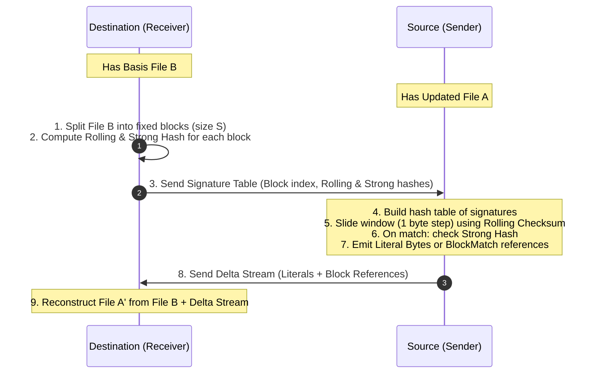
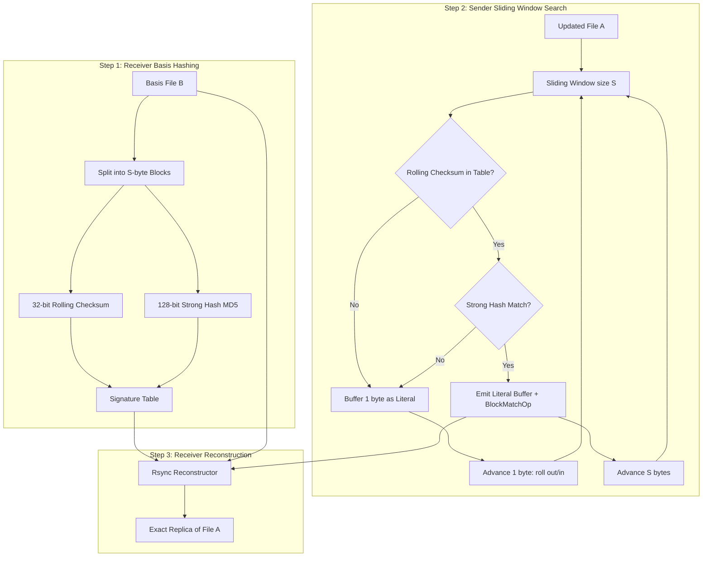

# Rsync (Remote Synchronization) — Rolling Checksum Algorithm

A production-grade Java 17 reference implementation of the **Rsync Algorithm** (Andrew Tridgell & Paul Mackerras, 1996), featuring Tridgell's $O(1)$ rolling checksum, strong 128-bit cryptographic block hashing (MD5), sliding-window delta generation, and basis reconstruction.

---

## Table of Contents
1. [What is Purpose of It?](#1-what-is-purpose-of-it)
2. [Why We Are Using It?](#2-why-we-are-using-it)
3. [When We Should Use It?](#3-when-we-should-use-it)
4. [What is Tradeoff of It?](#4-what-is-tradeoff-of-it)
5. [Advantages and Disadvantages](#5-advantages-and-disadvantages)
6. [Alternatives to Rsync](#6-alternatives-to-rsync)
7. [How Rsync Works — Architecture & Algorithm](#7-how-rsync-works--architecture--algorithm)
8. [Rolling Checksum Mathematics](#8-rolling-checksum-mathematics)
9. [Project Structure](#9-project-structure)
10. [Build & Run](#10-build--run)

---

## 1. What is Purpose of It?

The primary purpose of **Rsync (Remote Sync)** is to synchronize a file or dataset between two endpoints (e.g., local machine and remote server) when the destination endpoint already has an earlier or similar version of the file.

Instead of transferring the entire modified file over a slow or bandwidth-constrained network, Rsync detects identical blocks between the two versions and **only transmits the deltas (modified bytes and block references)**.



---

## 2. Why We Are Using It?

In distributed systems, cloud computing, and DevOps pipelines, files are frequently updated by appending, inserting, or modifying small sections rather than rewriting them from scratch (e.g., database backups, VM disk images, container layers, code repositories, logs).

- **Massive Bandwidth Savings:** If a 1 GB file has 1 MB of changes, transferring the full file wastes 99.9% of bandwidth. Rsync transfers ~1 MB of payload plus small signature metadata.
- **Offset-Shift Invariance:** Simple diff tools and fixed-block algorithms break when a single byte is inserted at the beginning because every subsequent block offset changes. Rsync's **rolling window** slides byte-by-byte and recovers alignment at the very next block boundary.
- **Low Latency for Incremental Updates:** Reduces transfer time from hours to seconds for large data files with incremental revisions.

---

## 3. When We Should Use It?

### Recommended Use Cases
- **Incremental File Synchronization & Backups:** Nightly sync of log archives, VM disk snapshots, large database dumps.
- **Continuous Deployment & Artifact Delivery:** Shipping new binary releases or container layers where 90%+ of dependencies are unchanged.
- **Peer-to-Peer & Distributed File Systems:** Delta sync in distributed storage (e.g., Dropbox, Seafile, BitTorrent sync engines).
- **Mobile / Edge Device Sync:** Synchronizing datasets to edge devices over unreliable, metered, or low-bandwidth cellular networks.

### When NOT to Use
- **Completely Unrelated Files:** If the destination does not have a prior version, Rsync introduces unnecessary signature exchange overhead.
- **Heavily Compressed or Encrypted Files without deterministic chunking:** Standard gzip/AES changes almost 100% of bytes when 1 byte changes, neutralizing delta matching (use *rsync-friendly compression* e.g., `gzip --rsyncable` instead).
- **Very Tiny Files (< 1 KB):** Signature computation and round-trip communication overhead outweigh transmitting the raw file.

---

## 4. What is Tradeoff of It?

| Dimension | Full File Transfer (SCP / FTP) | Rsync Delta Sync |
|-----------|-------------------------------|------------------|
| **Network Bandwidth** | $O(N)$ (High) | $O(\text{Deltas} + \text{Signatures})$ (Low) |
| **CPU Utilization** | Minimal (Zero hashing) | Moderate (Rolling hash + MD5 per block) |
| **I/O Overhead** | Single sequential read & write | Full read on receiver + sequential scan on sender + random/sequential reconstruct |
| **Network Round Trips** | 1 (Send file) | 2 (Send signatures $\to$ Send deltas) |
| **Memory Footprint** | Low stream buffer | $O(\text{Blocks})$ signature lookup table |

**The Core Tradeoff:** Rsync trades **CPU compute and local disk I/O** at both ends in exchange for **drastically reduced network bandwidth and transmission time**.

---

## 5. Advantages and Disadvantages

### Advantages
1. **Bandwidth Efficiency:** Up to 90–99% reduction in transmitted network data on incremental updates.
2. **Offset Invariance:** Recovers block matching even after arbitrary byte insertions or deletions in the middle of files.
3. **Idempotence & Safety:** Does not corrupt the destination if interrupted; files are reconstructed in temporary space or verified atomically.
4. **Collision Resistance:** Combines lightweight 32-bit rolling hash (fast rejection) with strong 128-bit cryptographic hash (MD5/SHA-256) to eliminate false matches.

### Disadvantages
1. **High Disk I/O:** Both sender and receiver must read their entire copy from disk to compute checksums and apply diffs.
2. **CPU Bound on High-Speed Networks:** On 10Gbps+ LANs, Rsync hashing may be slower than raw memory-to-memory network streaming.
3. **Encrypted/Compressed File Incompatibility:** High-entropy encrypted or non-rsyncable compressed data defeats block matching.

---

## 6. Alternatives to Rsync

| Alternative | Mechanism | Best Fit | Limitation |
|-------------|-----------|----------|------------|
| **Rsync (Tridgell)** | Fixed basis blocks + Rolling sender window | File sync over network, backups | 2-way round trip needed |
| **Content-Defined Chunking (CDC / FastCDC / Rabin)** | Variable-size blocks cut at content boundaries | Deduplication storage (Borg, Restic, IPFS, Git LFS) | Slightly higher compute per chunk |
| **Git / Version Control Diffs (Myers Diff)** | Line-based LCS (Longest Common Subsequence) | Source code text repositories | Unusable on large binary files |
| **Merkle Tree Sync** | Hierarchical hash tree comparison | Distributed DBs (Cassandra, DynamoDB, Blockchains) | Requires pre-indexed tree structure |
| **BitTorrent / Chunk Hashes** | Pre-computed static chunk manifest | P2P static file distribution | Static files only; no delta for shifts |

---

## 7. How Rsync Works — Architecture & Algorithm



---

## 8. Rolling Checksum Mathematics

Andrew Tridgell's rolling checksum is a 32-bit hash built from two 16-bit unsigned sums $s_1$ and $s_2$:

$$s_1(k, l) = \left( \sum_{i=0}^{l-1} X_{k+i} \right) \pmod{M}$$

$$s_2(k, l) = \left( \sum_{i=0}^{l-1} (l - i) \cdot X_{k+i} \right) \pmod{M}$$

where $M = 2^{16} = 65536$, $l$ is block size, and $X_j$ is the byte at offset $j$.

The combined 32-bit signature is:
$$R(k, l) = (s_1 \ \& \ \text{0xFFFF}) \mid ((s_2 \ \& \ \text{0xFFFF}) \ll 16)$$

### $O(1)$ Rolling Property
When sliding the window from $[k, k+l-1]$ to $[k+1, k+l]$, rolling out old byte $X_{k}$ and rolling in new byte $X_{k+l}$:

$$s_1' = (s_1 - X_k + X_{k+l}) \pmod{M}$$

$$s_2' = (s_2 - l \cdot X_k + s_1') \pmod{M}$$

Both equations execute in **$O(1)$ constant time** using simple bitwise operations and additions.

---

## 9. Implementations & Java Libraries

This repository provides three standalone Java implementations demonstrating different architectural and library approaches:

| Module | Core Dependencies | Rolling Hash | Strong Hash | Features |
|---|---|---|---|---|
| **`Rsync` (Core)** | Core Java 17 | Tridgell 32-bit | MD5 (128-bit) | Zero-dependency pure Java reference implementation with stats & metrics |
| **`Rsync-Guava`** | Google Guava 33+ | Adler-32 (Rsync v29) | Guava `SHA-256` / `MD5` | Immutable Multimaps, HashCode representation, ByteStreams |
| **`Rsync-Apache-Commons`** | Commons Codec & IO | Fletcher-32 | Commons `DigestUtils.md5Hex` | Hex digests, Apache Commons stream pipelines |

---

## 10. Project Structure

```
Rsync/
├── pom.xml
├── README.md
├── src/                                  # Core Java 17 Implementation
│   ├── main/java/com/example/rsync/
│   │   ├── BlockMatchOp.java             # Delta instruction for basis block reuse
│   │   ├── BlockSignature.java           # Metadata record for a basis block
│   │   ├── DeltaOp.java                  # Sealed interface for delta instructions
│   │   ├── LiteralOp.java                # Delta instruction containing raw literal bytes
│   │   ├── Main.java                     # Visual demonstration runner
│   │   ├── RollingChecksum.java          # O(1) Tridgell 32-bit rolling hash
│   │   ├── Rsync.java                    # Main facade API orchestrating sync
│   │   ├── RsyncDeltaGenerator.java      # Sliding window sender delta generator
│   │   ├── RsyncReconstructor.java       # Receiver-side file reconstructor
│   │   ├── RsyncSignatureGenerator.java  # Basis file chunker and signature table builder
│   │   ├── RsyncStats.java               # Bandwidth metrics and transfer statistics
│   │   ├── RsyncSyncResult.java          # Encapsulates reconstructed bytes & metrics
│   │   ├── SignatureTable.java           # Fast hash index for candidate block lookup
│   │   └── StrongChecksum.java           # Cryptographic MD5 hash generator
│   └── test/java/com/example/rsync/
│       ├── RollingChecksumTest.java      # Step-by-step rolling validation vs direct compute
│       └── RsyncTest.java                # Complete end-to-end sync test suite
│
├── Rsync-Guava/                          # Google Guava Submodule
│   ├── pom.xml
│   └── src/
│       ├── main/java/com/example/rsyncguava/
│       │   ├── Adler32RollingChecksum.java
│       │   ├── GuavaBlockSignature.java
│       │   ├── GuavaDeltaInstruction.java
│       │   ├── GuavaRsyncEngine.java
│       │   ├── GuavaSignatureTable.java
│       │   └── Main.java
│       └── test/java/com/example/rsyncguava/
│           └── GuavaRsyncTest.java
│
└── Rsync-Apache-Commons/                 # Apache Commons Submodule
    ├── pom.xml
    └── src/
        ├── main/java/com/example/rsynccommons/
        │   ├── CommonsBlockSignature.java
        │   ├── CommonsRsyncEngine.java
        │   ├── CommonsSignatureTable.java
        │   ├── Fletcher32RollingChecksum.java
        │   └── Main.java
        └── test/java/com/example/rsynccommons/
            └── CommonsRsyncTest.java
```

---

## 11. Build & Run

### Prerequisites
- **JDK 17+**
- **Maven 3.8+**

### 1. Core Reference Implementation
```bash
cd SYSTEM-DESIGN/Rsync
mvn clean test
mvn compile exec:java
```

### 2. Google Guava Module
```bash
cd SYSTEM-DESIGN/Rsync/Rsync-Guava
mvn clean test
mvn compile exec:java
```

### 3. Apache Commons Module
```bash
cd SYSTEM-DESIGN/Rsync/Rsync-Apache-Commons
mvn clean test
mvn compile exec:java
```

### Sample Demo Output
```text
================================================================================
               RSYNC ALGORITHM - REMOTE FILE SYNCHRONIZATION DEMO               
================================================================================

--------------------------------------------------------------------------------
>>> Scenario 1: Insertion at Start (Shift Offset Test)
--------------------------------------------------------------------------------
Basis file size        : 348 bytes (divided into 6 blocks of 64B)
Source file size       : 373 bytes
Delta operations       : 7 ops
  [1] LiteralOp[len=25 bytes]
  [2] BlockMatchOp[block=0, len=64]
  [3] BlockMatchOp[block=1, len=64]
  [4] BlockMatchOp[block=2, len=64]
  [5] BlockMatchOp[block=3, len=64]
  [6] BlockMatchOp[block=4, len=64]
  [7] BlockMatchOp[block=5, len=28]
Matched basis blocks   : 6 (348 bytes reused)
Literal data sent      : 1 chunks (25 bytes)
Signature overhead     : 144 bytes
Total network transfer : 228 bytes
Network bandwidth saved: 38.87%
Reconstruction match   : SUCCESS (Bit-for-bit identical)
```

---

## Author
**Jatin Ghataliya** · [prajapati.jatin94@gmail.com](mailto:prajapati.jatin94@gmail.com)
